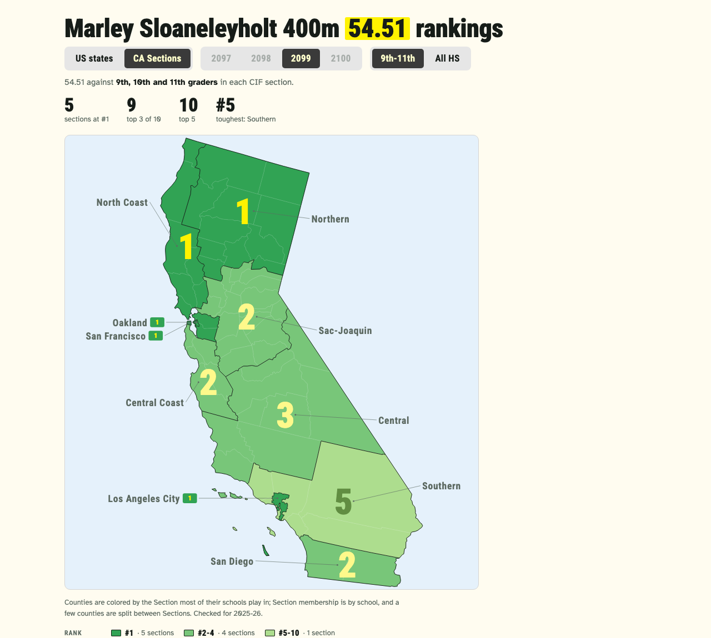
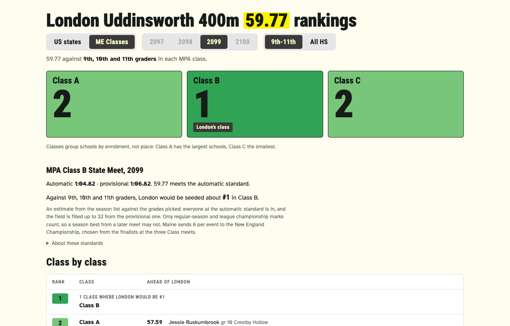
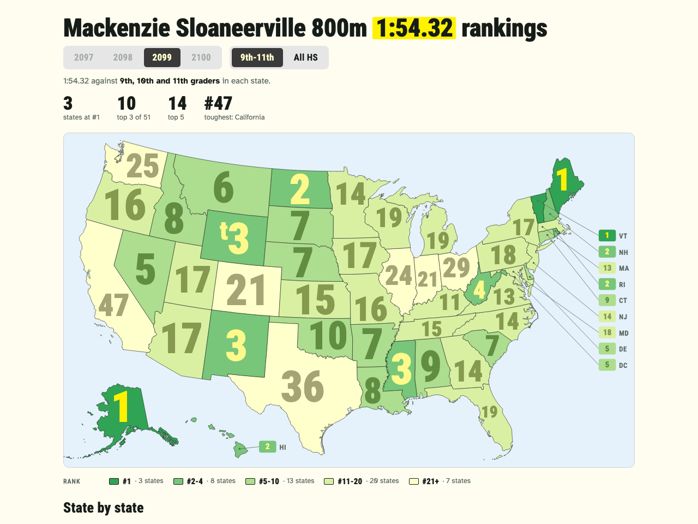
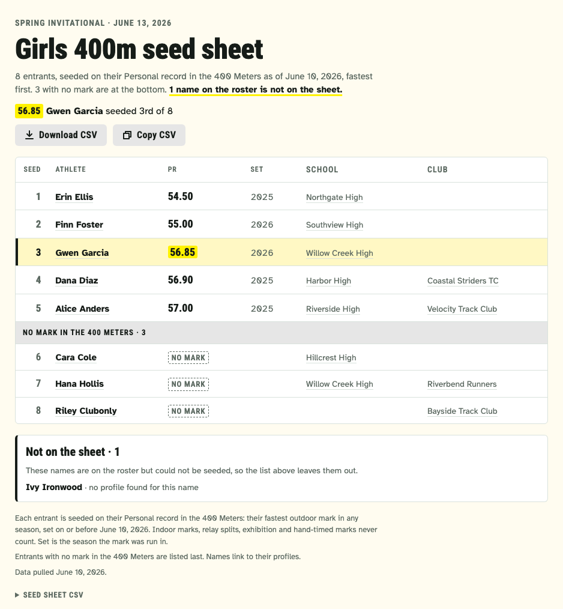
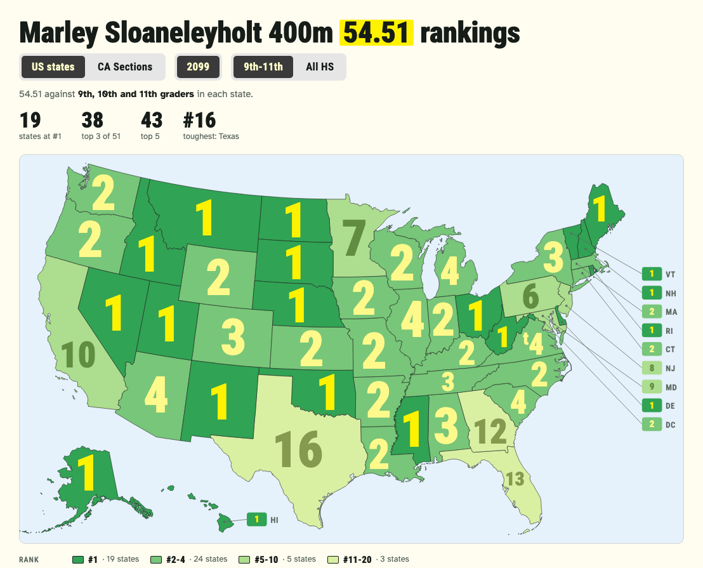

# ath

Tools for high school track and field coaches and families, built on [Athletic.net](https://www.athletic.net) data.

Open source, with contributions welcome: see [Contributing](#contributing).

- **`ath`** is a command-line app that reads Athletic.net for you.
  Its main job is seed sheets: give it a roster CSV and an event, and it writes the entrants ranked on each one's Personal record, as CSV.
  It also shows a meet's entries, a Profile, a whole Rankings list, and where an athlete would place on State and Area lists.
- **rankmap** answers "where would this athlete's season-best mark rank in every US state?"
  It builds one standalone page: a US map with the athlete's rank in each state, by season and grade group, a table of who is ahead, and the athlete's Section or Class in their home State ([below](#rankmap)).
- **seedsheet** turns a meet's seed sheets into one shareable page per event, made for a phone at the track ([below](#seed-sheet-page)).

**Real use needs a paid Athletic.net subscription,** signed in wherever `ath` reads Athletic.net: the browser tab of the relay, or the session a cookie comes from.
Athletic.net shows full Rankings lists only to a signed-in session with a paid subscription, and enforces that on its server: signed out you see 5 rows of a list, signed in without a subscription 25, and the rest are masked.
Signed in without a subscription, meet entries and athletes' marks are still readable, so `ath seed --meet` works, but an athlete's rankings are blurred.
rankmap, `ath rank` and `ath list` read whole State lists, so they need the subscription.
`ath` reads Athletic.net through your own session ([below](#reaching-athleticnet)), so it sees exactly what you see; it is not a way around the paywall, and it stops with an error on a capped list rather than rank against part of it ([ADR 0001](docs/adr/0001-athletic-net-access-is-cloudflare-gated.md)).

**This is an unofficial tool.**
It is not affiliated with or endorsed by Athletic.net.
Use it within [Athletic.net's terms](https://www.athletic.net/terms/), with your own account.
Be a good API citizen: `ath` limits how many requests run at once, waits between them, caches what it read and backs off when Athletic.net throttles it.
Keep `--concurrency` and `--delay-ms` at their defaults or gentler; do not raise the concurrency or shorten the delay.

**Examples:** see [below](#examples): three rankmap pages built from anonymized data, live at [jimnist.github.io/ath](https://jimnist.github.io/ath/).

## Examples

[`examples/`](examples/) builds a small site of example pages from anonymized Athletic.net data: invented names, schools and meets, seasons moved to the fictional 2099, and shifted marks, so ranks are realistic, not real ([ADR 0010](docs/adr/0010-anonymized-examples-and-fixtures.md)).
The site is live on GitHub Pages at [jimnist.github.io/ath](https://jimnist.github.io/ath/).
To build it yourself, run `python3 examples/build_site.py` and open `examples/site/index.html`.
Links on the examples all go to one page explaining that links work only on pages built from real data.

- **California** (girls 400m): the US map and the CIF Sections map, with the State Meet places by Section.

  

- **Maine** (girls 400m): one card per MPA Class, with the athlete's own Class meet standards.

  

- **Oregon** (boys 800m): a State without an Area file, so the US map and the State list only.

  

A seed sheet example is coming.
How the examples are made and rebuilt: [`docs/anonymize.md`](docs/anonymize.md#the-examples).

## Getting started

1. [Install](#install) `ath`, or build it with `cargo build --release`.
2. Connect it to Athletic.net through the [browser relay](#setting-up-the-browser-relay), in a browser signed in to your paid account.
3. Keep your configs, rosters and collected data in [`local/`](#your-own-configs-and-data-local), which git ignores.
4. Build a [seed sheet](#usage), a [seed sheet page](#seed-sheet-page) or a [rankmap](#rankmap).

**Add your State:** rankmap knows the Areas (Sections, Classes) and State Meet rules of the States that have a file in `areas/`.
To add yours, follow [`docs/areas.md`](docs/areas.md#adding-a-state), the contributor guide, and open a pull request; or open an "Add my State" issue with what you know.

See [`docs/HANDOFF.md`](docs/HANDOFF.md) for the full build spec - data sources,
the hard-won encodings (gender-specific event IDs, `SortInt`, relay splits), the
Qualifying mark filter, and per-event output behavior.

## Usage

`ath` is a subcommand CLI: `ath seed` builds a seed sheet, [`ath meet`](#ath-meet) shows a meet's events and entries, [`ath profile`](#ath-profile) shows one person's Profile, [`ath areas`](#ath-areas) lists a State's Areas, [`ath list`](#ath-list) prints a whole Rankings list and [`ath rank`](#ath-rank) places an Athlete on State and Area lists.
Seeding is `ath seed`:

```
$ ath seed --roster roster.csv --event "400 Meters" --meet-date 2027-05-15 --out seed.csv
```

Each entrant is seeded on their Personal record in the event as of today: the fastest Qualifying mark they have ever run, in any outdoor season, not just this season's best.
Indoor marks, relay splits, exhibition, hand-timed marks and DNS/DNF/NT/SCR/DQ/FS never count, and entrants with no Qualifying mark go to the bottom with a blank `pr`.
A bare number such as `--event 400` names no event and is refused with a hint (`did you mean 400m?`), as every command does.
The `pr_season` column (last, so the earlier columns keep their positions) says which season the Personal record was set in, so an old one stands out.

Besides writing the CSV, `ath seed` prints the same sheet under the [output contract](#output-json-or-table): a table in a terminal, JSON otherwise (`--json` / `--table` force either).
The JSON's `entrants` are the CSV's rows in the CSV's order, with the CSV's columns, each followed by the Personal record's `SortInt` (`sort_int`, what the sheet is sorted on), `null` for no mark.
`as_of` is the day the marks are as of, `meet_date` the `--meet-date` given (or `null`), and `event_name` the event's own name (`400 Meters`).
Every roster row missing from the sheet is listed with why: `skipped` for an athlete whose Profile could not be read, and `unresolved` for a row that did not resolve to one athlete (`reason` is `no_match`, `ambiguous` or `search_failed`, and `note` says what to do).
When no row resolves, `ath seed` writes no CSV but still prints the sheet, with no entrants and every row in `unresolved`.
The [seed sheet page](#seed-sheet-page) renders it.

```
$ ath seed --roster roster.csv --event 400m --json | jq '.schema, .as_of, .entrants[0], .unresolved'
1
"2026-06-10"
{
  "rank": 1,
  "athlete": "Erin Ellis",
  "athlete_id": 1004,
  "athlete_url": "https://www.athletic.net/athlete/1004/track-and-field",
  "pr": "54.50",
  "pr_numeric": 54.5,
  "school": "Northgate High",
  "school_url": "https://www.athletic.net/team/504/track-and-field-outdoor",
  "club": "",
  "club_url": "",
  "pr_season": 2025,
  "sort_int": 54500
}
[
  {
    "name": "Ivy Ironwood",
    "reason": "no_match",
    "note": "no Profile matches the name; pin an athlete_id"
  }
]
```

Seed sheets are only for upcoming meets.
`--meet-date` is optional.
Without it, or for a meet after today, marks are as of today.
For a meet today, marks are as of the day before, so a result from the meet itself never becomes its seed; results with no date are left out too, since they may be from the meet.
A meet date in the past is refused and nothing is written: `ath` does not reconstruct a past seeding.

> **Breaking change:** `ath seed --season` was removed, because a Personal record spans every season.
> Drop it from the command line; passing it is an "unexpected argument" error.

Live runs fetch Athletic.net through a tab in your own browser by default, set up once with `ath relay install` ([below](#reaching-athleticnet)).

The global options (cookie, user agent, relay, cache, concurrency, delay, output format) are shared by every subcommand and go before or after the subcommand name, so `ath --cookie-file cookie.txt seed ...` and `ath seed ... --cookie-file cookie.txt` are the same run.

> **Breaking change:** the old bare form `ath --roster ... --event ...` was removed with no alias (see [ADR 0007](docs/adr/0007-ath-owns-data-python-reports-render.md)).
> Running it exits with an error that points at `ath seed`; add `seed` after `ath` and keep the rest of the command line as it was.

```
$ ath --help
Generate meet seed sheets from Athletic.net, CSV in / CSV out.

Usage: ath [OPTIONS] <COMMAND>

Commands:
  seed     Build a ranked seed sheet CSV for one event from a roster CSV or a meet's entries, and print it
  meet     Show a meet: its date, season, divisions and the events with entries, or with --event one event's entries (relays by team and leg)
  profile  Show a Profile, with its Area and its Season best and Personal record in one event
  areas    List a State's Areas for a season, with the list id of each and of the State
  list     Print a whole Rankings list (a State's or an Area's) for one event, season and Grade group
  rank     Place an Athlete on State and Area Rankings lists, for each Grade group, with the people around them
  relay    Set up the browser relay that fetches Athletic.net through your browser
  help     Print this message or the help of the given subcommand(s)

Options:
  -h, --help     Print help
  -V, --version  Print version

Global options:
      --cookie <COOKIE>            Athletic.net session cookie: fetch with it (the cookie transport) instead of through the browser relay. Also read from the `ATH_COOKIE` env var
      --cookie-file <FILE>         Read the session cookie from a file instead of `--cookie`
      --user-agent <UA>            User-Agent to send with the cookie. Must match the browser the cookie came from (`cf_clearance` is bound to it)
      --concurrency <CONCURRENCY>  Max bios fetched concurrently (`ath list` reads its pages one at a time) [default: 5]
      --delay-ms <DELAY_MS>        Delay between concurrent batches of bios, and between rankings list pages, in milliseconds [default: 250]
      --refresh                    Ignore cached responses and refetch (still writes fresh entries to the cache)
      --no-cache                   Do not read or write the response cache
      --cache-dir <DIR>            Response cache directory. Defaults to the OS cache dir under `ath/responses`
      --json                       Print JSON (the default when stdout is not a terminal)
      --table                      Print a readable table (the default when stdout is a terminal)
      --relay-port <PORT>          Port on 127.0.0.1 for the browser relay (the bookmarklet is made for it) [default: 8767]
      --relay-timeout <SECONDS>    Seconds to wait for the Athletic.net tab to connect to the browser relay (1 to 3600) [default: 30]
      --record-dir <DIR>           Also write every Athletic.net response this run reads (cached ones too) into DIR, in the layout `--fixtures-dir` reads, so the same command with `--fixtures-dir DIR` replays it offline. No tokens are written. Real people: DIR must be outside any git work tree, or one its git ignores (such as `local/recordings/<scenario>`). See docs/anonymize.md
```

```
$ ath seed --help
Build a ranked seed sheet CSV for one event from a roster CSV or a meet's entries, and print it

Usage: ath seed [OPTIONS] --event <NAME> <--roster <FILE>|--meet <MEET_ID>>

Options:
      --roster <FILE>           Roster CSV (one athlete per row; `name` required, `athlete_id` pins a known athlete)
      --meet <MEET_ID>          Seed a meet's accepted entrants instead of a roster: the Athletic.net meet id. Needs --gender and --div; the meet date comes from the meet
      --gender <GENDER>         With --meet: the girls' (f) or boys' (m) event [possible values: f, m]
      --div <DIV>               With --meet: the division, by id (as the entries page's URL has it), name or short name ("13", "Varsity" or "V")
      --event <NAME>            Event to seed on, by Athletic.net name (e.g. "800 Meters"); a flat race also takes the short form "800m". With --meet, the meet's event, by its code ("800m", "1mile", "4x800m") or name. Entrants are seeded on their Personal record in it as of today, across all outdoor seasons. A relay of four equal legs (with --meet only; a roster cannot name teams) is seeded per team on the sum of its runners' Personal records in its Seeding event: 4x100m on the 100m, 4x200m on the 200m, 4x400m on the 400m, 4x800m on the 800m, 4xMile on the 1600m (or each runner's mile, converted to the 1600m and flagged as an Estimated mark, when faster). Medley and shuttle relays are not seeded yet
      --seed-on <EVENT>         With --meet and a relay: seed each runner on this event instead of the relay's own leg distance, by Athletic.net name ("1 Mile") or a flat race's short form ("1600m"), with no conversion (a 4xMile then reads no mile)
      --meet-date <YYYY-MM-DD>  Date of the meet being seeded (not with --meet, which reads it from the meet). Refused if it is in the past: a seed sheet is for an upcoming meet. Marks are as of today, or as of the day before for a meet today
      --out <FILE>              Output seed sheet CSV [default: seed.csv]
      --fixtures-dir <DIR>      Offline mode: read bios from `<DIR>/<athlete_id>.json`, a roster's name searches from `<DIR>/search/<name>.json`, and with --meet the meet from `<DIR>/meets/<meet_id>/`, instead of the live API (skips the cookie, the relay and the network entirely)
      --resolution-log <FILE>   Write an opt-in CSV log of what auto-resolved and why
  -h, --help                    Print help

Global options:
  (same as above)
```

### `ath seed --meet`

Instead of a roster, `ath seed` can take its entrants from a meet's entries on Athletic.net (Mode A), for one running event, individual or [relay](#relays), in one division:

```
$ ath seed --meet 900700 --gender m --div 13 --event 800m --out seed.csv
```

`--div` is the division's id (the number in the entries page's URL), name or short name (`13`, `Varsity` or `V`), and `--event` the meet's event by its code or name (`800m`, `1mile`, `800 Meters`); [`ath meet`](#ath-meet) lists both.
The entrants are the entries Athletic.net has accepted and that are not scratched.
Each one's Profile is read by athlete id, with no name search, and seeded exactly as a roster's entrant is: on the Personal record in the event as of today, or as of the day before for a meet today.
The meet date is the meet's own, so `--meet-date` is not taken: marks are as of the day before the meet starts at the latest, and a meet is refused once it is over.
`--roster` and `--meet` cannot be combined: a run seeds one or the other, so a roster that stands in for one event of a meet is its own `ath seed --roster` run for that event.

The CSV is the same, and the printed sheet adds `meet`: the meet (`id`, `name`, `date`, `season_id`, `indoor`, `url`), the `event` in its division (`url` is its entries page) and `left_out`, the entries that are not on the sheet, with a `reason` (`scratched`, `not_accepted` for any `AcceptanceStatus` but 10, or `no_athlete`).

```
$ ath seed --meet 900700 --gender m --div 13 --event 800m --out 900700-m-800m.csv --json | jq '.meet | {name, date, event: .event.url, left_out: [.left_out[] | {name, reason}]}'
```

Without `--out`, the CSV is written to `seed.csv` in the current directory, replacing one already there; give each event its own `--out`.

Some events are refused from the meet's event list, before any entries are read.
Medley and shuttle relays are not seeded yet (told by code or name: `SMR 1600m`, `sprintmed2248`, `DMR`, shuttle hurdles), since their legs are not one distance: `ath seed --meet` on one stops and points at `ath meet`, which shows the teams and their legs, even for a relay only run indoors.
A relay whose leg distance cannot be read (yards, or a bare number that is no standard race, such as `4x4`) is refused saying so, and so is an event whose entries are relay legs but whose name and code say nothing of a relay.
Field events are refused too, and so are events only run indoors (55m, 60m and their hurdles, 300m, 500m, 600m, 1000m), since seeding reads outdoor Personal records only.
When Athletic.net denies the event list or entries (401/403, or an authorization denial), `ath` fetches a fresh meet token and tries once more; a second refusal says a paid Athletic.net subscription may be needed.

#### Relays

A relay whose four legs are one flat race (`4x100m`, `4x200m`, `4x400m`, `4x800m`, `4xMile`, by code or name) is seeded per team, from the meet's entries only.
A roster (Mode B) names people, not teams: `ath seed --roster ... --event 4x800m` is refused, saying to use `--meet`.
Each team is a school's `A` team, or `B` for its second.
Its runners are legs 1 to 4, each the first entry with that leg number: another entry for a leg already filled, or one with no leg number (an alternate), never takes its place, and a leg with no entry leaves the team a runner short.
One athlete on two legs of a team leaves it without an aggregate too ("Same runner on legs 1 and 3").
When no team's entries carry leg numbers at all, `ath seed` stops with that reason and writes nothing.
Every runner is seeded exactly as an individual entrant is, on their Personal record in the relay's Seeding event: outdoor Qualifying marks only, as of the same day, so relay splits and indoor marks never count.
A team's aggregate, its seed mark, is the sum of its four runners' `SortInt`s, and teams are sorted fastest first on it.
A team with a leg that has no runner, or with a runner who has no mark in the Seeding event (or whose Profile could not be read), has no aggregate and goes to the bottom, in entry order, still showing every runner and the marks they have.

| Relay | Seeding event |
| --- | --- |
| 4x100m | 100m |
| 4x200m | 200m |
| 4x400m | 400m |
| 4x800m | 800m |
| 4xMile | 1600m, or the 1 Mile as an Estimated mark when faster |

On a 4xMile, each runner is seeded on the faster of their 1600m Personal record and their 1 Mile Personal record converted to the 1600m at even pace (mile time x 1600 / 1609.344), both read by the same rules.
The conversion is on `SortInt` milliseconds, rounded up to the next hundredth (so an estimate never looks faster than the conversion, and `sort_int` is exactly the mark shown, so the aggregate is the sum of the legs shown); a tie goes to the real 1600m.
A converted mile is an Estimated mark ([`CONTEXT.md`](CONTEXT.md)), always flagged: the leg has `estimated: true`, and the team `estimated: true` (its aggregate includes estimated legs).

`--seed-on` seeds the runners on one other event instead, with no conversion, by Athletic.net name (`"1 Mile"`) or a flat race's short form (`1600m`).
It must be one individual flat running race: a relay (`4x400m`), a field event (`Shot Put`), hurdles or an event only run indoors is refused, and so is `--seed-on` with an individual event.
A relay whose own legs are only run indoors is refused naming its legs; these refusals come from the meet's event list, before any entries are read.

```
$ ath seed --meet 900700 --gender m --div 13 --event 4x800m --out 900700-m-4x800m.csv
$ ath seed --meet 900700 --gender m --div 13 --event 4xmile --seed-on "1 Mile" --out 900700-m-4xmile.csv
```

The relay CSV is one row per team (`docs/HANDOFF.md` §6): `rank, team, letter, team_url, aggregate, aggregate_seconds, aggregate_estimated, no_aggregate_reason`, then for each leg N from 1 to 4 `runnerN, runnerN_id, runnerN_url, runnerN_pr, runnerN_estimated_from`.
`aggregate_estimated` is `true` when any leg's mark is estimated, `no_aggregate_reason` says why a team has no aggregate, leg by leg number ("Leg 4 has no 800 Meters mark; Leg 3 has no runner"), and `runnerN_estimated_from` says what an estimated mark was made from (`1 Mile 5:02.10`, blank for a real mark); a leg with no runner, or a runner with no mark, has blank cells.
The printed sheet is `schema` 1 with `kind: "relay"` (an individual sheet has no `kind`): the individual sheet's `event`, `event_name` (the meet's, `4x800 Relay`), `as_of`, `meet_date`, `meet`, `skipped` and `unresolved` (always empty), plus `seeding_event` (`800m`, or `--seed-on`'s value), `seeding_event_name` (`800 Meters`), `estimate_from` (`1 Mile` on a 4xMile, else `null`), and `teams` where an individual sheet has `entrants`.
Each team has `rank`, `team` (the school), `letter`, `team_url`, `aggregate`, `aggregate_seconds`, `sort_int` (the aggregate's `SortInt`, `null` without one), `team_id`, `school_id`, `entered_sort_int`, `missing_legs` (the leg numbers with no runner), `same_runner_legs` (groups of legs one athlete is entered on, `[[1, 3]]`), `no_aggregate_reason` (`null` with an aggregate), `estimated` and `legs`.
Each leg has `leg` (1 to 4), `athlete`, `athlete_id`, `athlete_url`, `grade`, `pr`, `pr_numeric`, `pr_season`, `sort_int`, `estimated`, and for an estimated mark `estimated_from` (`1 Mile`), `estimated_from_pr` (`5:02.10`) and `estimated_from_sort_int` (all `null` for a real mark).

```
$ ath seed --meet 900700 --gender m --div 13 --event 4x800m --out relay.csv --fixtures-dir tests/fixtures --table
...
4x800 Relay seed sheet: the sum of each team's 800 Meters Personal records as of 2026-11-07, for Riverton Winter Classic (meet 900700) on 2099-01-09, boys Varsity
4 teams, 2 with an aggregate

Seed  Team                 Aggregate     Leg  Athlete        Grade  PR       Season  Profile
1     Harbor View High A   7:59.05       1    Kai Lowell     12     1:57.40  2026    https://www.athletic.net/athlete/900100021/track-and-field
                                         2    Bram Ostrow    12     1:59.90  2025    https://www.athletic.net/athlete/900100022/track-and-field
...
3     Pinecrest Academy B  no aggregate  1    Jude Calloway  10     2:04.30  2026    https://www.athletic.net/athlete/900100015/track-and-field
...
                                         4    Finch Dorsey   9      no mark          https://www.athletic.net/athlete/900100018/track-and-field
4     Lakemont Prep A      no aggregate  1    Dex Arden      11     2:03.00  2026    https://www.athletic.net/athlete/900100031/track-and-field
...
                                         4    (no runner)
```

### `ath meet`

`ath meet <MEET_ID>` shows a meet: its name, date, season (indoor or outdoor), place and divisions, and every event and division that has entries, each with its entries page.
These are the events a seed sheet for "every event" of the meet goes through, and the `--div` and `--event` values `ath seed --meet` takes.
The examples here read the made-up meet in `tests/fixtures`.

```
$ ath meet 900700 --fixtures-dir tests/fixtures --table
Meet 900700: Riverton Winter Classic, 2099-01-09, 2099 Indoor, Riverton Fieldhouse, Riverton, NY
https://www.athletic.net/TrackAndField/meet/900700
Divisions: Varsity (V, 13), Junior Varsity (JV, 14)

7 events with entries:
Gender  Division        Event                 Code           Relay  Entries
f       Varsity         800 Meters            800m                  https://www.athletic.net/TrackAndField/meet/900700/entries/f/13/800m
m       Varsity         800 Meters            800m                  https://www.athletic.net/TrackAndField/meet/900700/entries/m/13/800m
m       Varsity         4x800 Relay           4x800m         relay  https://www.athletic.net/TrackAndField/meet/900700/entries/m/13/4x800m
m       Varsity         Shot Put              Shot                  https://www.athletic.net/TrackAndField/meet/900700/entries/m/13/Shot
m       Varsity         SMR 1600m             sprintmed2248  relay  https://www.athletic.net/TrackAndField/meet/900700/entries/m/13/sprintmed2248
m       Varsity         4x55 Shuttle Hurdles  55shuttleh     relay  https://www.athletic.net/TrackAndField/meet/900700/entries/m/13/55shuttleh
m       Junior Varsity  55 Meters             55m                   https://www.athletic.net/TrackAndField/meet/900700/entries/m/14/55m
```

With `--gender`, `--div` and `--event` (all three), it also prints that event's entries (`entries`): an individual event's Entrants (`entrants`, each with athlete id, grade, school and entered mark as its `SortInt`), or a relay's teams (`teams`: each school's `A` team, `B` for its second, with its entered seed and its runners in leg order), plus the entries left out (`left_out`, scratched or not accepted, with why).

```
$ ath meet 900700 --gender m --div V --event 4x800m --fixtures-dir tests/fixtures --table
...
4x800 Relay (4x800m), boys Varsity: 4 teams, 0 left out
https://www.athletic.net/TrackAndField/meet/900700/entries/m/13/4x800m

Team                 Entered  Leg  Athlete        Grade  Profile
Pinecrest Academy A  8:02.00  1    Ezra Holt      12     https://www.athletic.net/athlete/900100011/track-and-field
                              2    Nico Vance     11     https://www.athletic.net/athlete/900100012/track-and-field
                              3    Silas Reed     11     https://www.athletic.net/athlete/900100013/track-and-field
                              4    Arlo Penn      10     https://www.athletic.net/athlete/900100014/track-and-field
Pinecrest Academy B  8:21.50  1    Jude Calloway  10     https://www.athletic.net/athlete/900100015/track-and-field
                              2    Rhys Monroe    9      https://www.athletic.net/athlete/900100016/track-and-field
                              3    Abel Tran      10     https://www.athletic.net/athlete/900100017/track-and-field
                              4    Finch Dorsey   9      https://www.athletic.net/athlete/900100018/track-and-field
Harbor View High A   8:10.30  1    Kai Lowell     12     https://www.athletic.net/athlete/900100021/track-and-field
                              2    Bram Ostrow    12     https://www.athletic.net/athlete/900100022/track-and-field
                              3    Otis Wren      11     https://www.athletic.net/athlete/900100023/track-and-field
                              4    Cyrus Hale     11     https://www.athletic.net/athlete/900100024/track-and-field
Lakemont Prep A      8:25.00  1    Dex Arden      11     https://www.athletic.net/athlete/900100031/track-and-field
                              2    Lev Okafor     10     https://www.athletic.net/athlete/900100032/track-and-field
                              3    Wade Pruitt    12     https://www.athletic.net/athlete/900100033/track-and-field
```

The JSON (`schema` 1) has `id`, `name`, `date`, `season_id`, `indoor`, `url` (the meet's page), `end_date` (its last day, its `date` for a one-day meet), `season` (`2027 Indoor`), `location`, `city`, `state`, `relay_athletes` (runners per relay team), `divisions` (`id`, `name`, `short`), `events` (`gender`, `division_id`, `division`, `event_id`, `event`, `event_short`, `relay`, `url`) and, with `--event`, `entries`.

With `--resolve` as well, `ath meet` only finds the event and division, exactly as `ath seed --meet` finds them (an event by its code, a flat race's short form or name, or its name; a division by id, name or short name), and prints it as `resolved` (an `events` row), without reading its entries.
It fails, saying why, when the meet has no such event with entries in the division.
The seed sheet page's meet mode uses it to find each event a config lists, so it never matches names itself.

```
$ ath meet 900700 --gender m --div varsity --event "800 Meters" --resolve --fixtures-dir tests/fixtures --table
...
800 Meters (800m), boys' Varsity (division 13)
https://www.athletic.net/TrackAndField/meet/900700/entries/m/13/800m
```
The meet, its event list and its entries are cached for about an hour.
`--fixtures-dir` reads recorded responses instead (`meets/<meet_id>/meet.json`, `events.json` and `entries/<gender>-<div_id>-<eventShort>.json`).

### `ath profile`

`ath profile <ATHLETE_ID>` shows a Profile: name, gender, teams (school or club, by Athletic.net's team level), current school and Area.
With `--event`, it also shows the Season best and Personal record in that event, each with its mark, `SortInt`, date and meet.

```
$ ath profile 2001 --event 400m --as-of 2026-04-01 --table
Name     Dana Diaz
Gender   F
School   Harbor High
Area     none for 2026 - OR has no Area level configured in ath
Profile  https://www.athletic.net/athlete/2001/track-and-field

Team                 Kind    Year  URL
Harbor High          school  2026  https://www.athletic.net/team/601/track-and-field-outdoor
Bayview Middle       school  2024  https://www.athletic.net/team/602/track-and-field-outdoor
Coastal Striders TC  club    2026  https://www.athletic.net/team/9101/track-and-field-outdoor

400 Meters as of 2026-04-01 (season 2026)
                 Mark   SortInt  Date        Meet
Season best      58.20  58195    2026-03-14  Spring Opener
Personal record  56.90  56904    2025-05-10  League Finals
```

Both bests are computed from the Profile's results: the lowest `SortInt` among Qualifying marks set on or before the `--as-of` date (default today), the Season best within that date's season.
`--season` picks another outdoor season.
`--as-of` and `--season` also work without `--event`; then they only pick the season of the School and the Area.
Indoor marks never count toward either best in v1 (see the Qualifying mark in [`CONTEXT.md`](CONTEXT.md)), so indoor season ids (10000 and up) are refused.
A result with no date counts as of today, but not as of an earlier `--as-of` date.
Athletic.net's own best flags only mark today's bests, so they are not used.
`--event` takes the Athletic.net event name (`"400 Meters"`, any case) or a flat race's short form (`400m`), as `ath seed` does; other short codes such as `LJ` are not accepted, and a bare number such as `--event 400` is refused with a hint (`did you mean 400m?`), as every command does.
When there is no Personal record, `ath` still exits 0 with empty bests and prints a warning saying why: the Profile has no results in the event, it is a field event (v1 reads running events only), or none of its results is a Qualifying mark on or before the date.
The JSON says the same in `event.status`: `ok`, `not_on_profile`, `field_event` or `no_qualifying_mark`.

The School is the Profile's school (middle or high, never a club) for the season: the one Athletic.net's `grades` record lists the person on that season, preferring a high school.
Only when that record lists no school for the season does `ath` fall back to each team's `Year`, the last season the person was on it: the school whose `Year` is the earliest at or after the season (a transfer's new school only from its first season on; a team with no `Year` counts as current).
A season before every school's `Year` gives the earliest school as a guess, and when no school's `Year` reaches the season it is the current school (the Profile's own team, otherwise the most recent school); either way the Area note says so.
The Area is the one Athletic.net lists that school in for the season, when it is a high school; a club never decides it.
The JSON has it as `area` (`id`, `name`, `level`, `state`, `season` and the `url` of its rankings list), or `null`, with `area_lookup` saying why.
`area_lookup.status` is `ok`, `no_high_school`, `state_not_configured`, `not_listed` (the school is on no lists for the season), `not_in_an_area` or `lookup_failed`, and `area_lookup.note` explains it in words.
A failed lookup (Athletic.net could not be asked) never fails the command: the rest of the Profile still prints, and the error is the note.
With JSON output, a failed lookup or a school not listed for the season (whatever the Area) is also a warning on stderr; the table shows the note itself.
The Area link opens on the `--event` list when it is a flat race (`400m`), otherwise on the 100m.
The lookup costs one request for the school's division chain, plus two for the season's Area tree the first time (read through the chain's own State list; cached forever after).

The examples below run on the anonymized test fixtures (`--fixtures-dir tests/fixtures` with `ATH_TODAY=2099-10-30`, [ADR 0010](docs/adr/0010-anonymized-examples-and-fixtures.md)): the people, schools and ids are invented and the season is the fictional 2099, but the output is what `ath` prints on real data.

```
$ ath profile 982389051 | jq '.area'
{
  "id": 996953819,
  "name": "Central Coast",
  "level": "Section",
  "state": "CA",
  "season": 2099,
  "url": "https://www.athletic.net/TrackAndField/rankings/list/996953819/f/100m"
}
```

```
$ ath profile --help
Show a Profile, with its Area and its Season best and Personal record in one event

Usage: ath profile [OPTIONS] <ATHLETE_ID>

Arguments:
  <ATHLETE_ID>  Athletic.net athlete id (the number in the Profile URL)

Options:
      --event <NAME>        Event to show the Season best and Personal record for, by Athletic.net name (e.g. "400 Meters"); a flat race also takes the short form "400m"
      --as-of <YYYY-MM-DD>  Compute both bests from marks set on or before this date; the Season best and the Area are for this date's season. Defaults to today
      --season <YEAR>       Outdoor season (year) for the School, the Area and the Season best. Defaults to the as-of date's year. Indoor marks never count in v1, so indoor season ids (10000 and up) are refused
      --fixtures-dir <DIR>  Offline mode: read recorded responses from DIR (`<athlete_id>.json`, `teamnav/<school_id>-<season>.json`, `navinfo/<season>.json`) instead of the live API (skips the cookie, the relay and the network)
  -h, --help                Print help

Global options:
  (same as above)
```

### `ath areas`

`ath areas <STATE> --season <YEAR>` lists a State's Areas for a season: the State's own rankings list and each Area's, with its list id and Athletic.net link.
List ids change every season, so `ath` discovers them from Athletic.net's rankings navigation each season and never hardcodes them.
It starts from one rankings list in any season (`--from-list`, default California's 2026 list), uses only its token, and follows Athletic.net's season map to the season asked for.
Which level counts as a State's Area is configured per State in `areas/<ST>.json` ([`docs/areas.md`](docs/areas.md)): California (the CIF sections) and Maine (the MPA classes); a State without a file lists only its own list and says it has no Areas.
Athletic.net's national tree does not list Maine's classes, so for a State whose Areas it lacks `ath` reads the State's own subtree through the State's list (two more requests, cached forever).
A season Athletic.net does not have yet is an error: `Athletic.net has no 2027 season yet`.
A season's Area tree is cached forever when it is Athletic.net's national high school tree, so after the first run (up to four requests) it costs none; a missing season is remembered for six hours for the start list that showed it missing.
Links open the rankings list on `--event` (default 100m); `--gender` picks the girls' (`f`, the default) or boys' list, which share their ids.
A bare number such as `--event 400` is refused with a hint (`did you mean 400m?`).

```
$ ath areas CA --season 2099 --table
California (CA) 2099 - Area level: Section

List           Kind   Id         URL
California     state  985316289  https://www.athletic.net/TrackAndField/rankings/list/985316289/f/100m
Central        area   901802829  https://www.athletic.net/TrackAndField/rankings/list/901802829/f/100m
Central Coast  area   996953819  https://www.athletic.net/TrackAndField/rankings/list/996953819/f/100m
Los Angeles    area   971769174  https://www.athletic.net/TrackAndField/rankings/list/971769174/f/100m
North Coast    area   927426852  https://www.athletic.net/TrackAndField/rankings/list/927426852/f/100m
Northern       area   917066756  https://www.athletic.net/TrackAndField/rankings/list/917066756/f/100m
Oakland        area   941478008  https://www.athletic.net/TrackAndField/rankings/list/941478008/f/100m
Sac-Joaquin    area   959072199  https://www.athletic.net/TrackAndField/rankings/list/959072199/f/100m
San Diego      area   984797709  https://www.athletic.net/TrackAndField/rankings/list/984797709/f/100m
San Francisco  area   936077076  https://www.athletic.net/TrackAndField/rankings/list/936077076/f/100m
Southern       area   914131242  https://www.athletic.net/TrackAndField/rankings/list/914131242/f/100m
```

The JSON has `state`, `season`, `gender`, `event`, `level` (`null` without a configuration), `state_list` and `areas` (each `{id, name, url}`), and `note` saying why a State has no Areas (also a warning on stderr with JSON output).

```
$ ath areas --help
List a State's Areas for a season, with the list id of each and of the State

Usage: ath areas [OPTIONS] <STATE>

Arguments:
  <STATE>  Two-letter State code (e.g. CA)

Options:
      --season <YEAR>        Season (year). Defaults to this year
      --gender <GENDER>      Gender of the rankings list links (list ids are the same for both) [default: f] [possible values: f, m]
      --event <EVENT>        Event the rankings list links open on: a flat race ("400m" or "400 Meters") or an Athletic.net event code such as Shot or LJ [default: 100m]
      --from-list <LIST_ID>  Rankings list (in any season) to find the season's lists from; only its token is used [default: 168546]
      --fixtures-dir <DIR>   Offline mode: read recorded responses from DIR (`navinfo/<season>.json`) instead of the live API (skips the cookie, the relay and the network)
  -h, --help                 Print help

Global options:
  (same as above)
```


### `ath list`

`ath list` prints a whole Rankings list: everyone on a State's or an Area's list for one event, season, gender and Grade group, in Athletic.net's order.
Name the list with `--state CA`, `--area "Central Coast"` (an Area's name or abbreviation such as `CCS`, any case; add `--state` when a name is in more than one State), or `--list <LIST_ID>` for any list id `ath areas` prints.
`--gender` is required, since a girls' list read as a boys' one would be silently wrong.
`--grades 9-10` (or `9,11`, or `11`) filters to a Grade group; without it the list has every grade.

Athletic.net serves a list 100 rows a page, with neighboring pages sharing two rows; `ath` reads every page in turn, keeps each person once, and orders the rows by `SortIntCalc`, the rankings rows' numeric sort key (lower is better).
`--limit N` stops once it has the first N rows, without reading the rest of the list.
Pages fetched from Athletic.net are read one at a time, `--delay-ms` apart (cached pages never wait), and the rest of the run slows down (one page a second or slower) the first time Athletic.net throttles or challenges a request.
California's girls' 400m list for 2026, every grade, is 11,389 people on 114 pages and took a little over two minutes through the browser relay.
Each page is cached: forever once its season is over (after July 31), for 12 hours while it is in progress.

The lists keep Athletic.net's default filters: fully automatic timed marks only (FAT) and official marks only.
Athletic.net answers some mistakes with another list instead of an error, so every page is checked and these are refused rather than printed: an event code it does not know (such as `SP` for shot put; the code is `Shot`) gets the 100m list, a list id from another season gets that season's list, and a list id it does not have gets no list at all.
Relay lists (`4x400m`) rank teams, not people, and are refused too: relays are out of v1 scope.
A list capped for a session without a paid subscription (only the first 5 or 25 rows, then masked placeholder rows) answers only what its first rows can: `--limit 10` still prints the first 10 (and `--limit 25` all 25, with a note that the last row's tie is unknown), but reading past the cap is an error that prints no rows and exits non-zero, such as `Athletic.net returned only 25 of at least 696 rows for California 2026 girls 400m (all grades); full lists need a paid Athletic.net subscription, ...`.
Capped pages are never cached, so the next run with a paid subscription reads the whole list.
When two pages disagree where they overlap (pages cached at different times while a season is in progress, or the list changed while it was read), `note` says so; `--refresh` reads the list again.

```
$ ath list --area CCS --event 400m --gender f --season 2099 --grades 9-10 --limit 2 --table
Central Coast (CA Section) 2099 girls 400 Meters, grades 9-10: first 2 (--limit) (FAT, official marks)
https://www.athletic.net/TrackAndField/rankings/list/996953819/f/400m?grades=9,10

Place  Name            Mark   Grade  Team                          Athlete
1      Emery Hollshaw  55.39  10     Cinderview Falls              935527399
2      Ryan Sallley    56.35  9      Pebblegate Heights Cathedral  942478467
```

The JSON has `list` (`{id, name, kind, state, level}`, `kind` being `state`, `area` or `list`), `season`, `gender`, `event`, `event_name`, `grades` (`null` for every grade), `fat` and `official` (the filters Athletic.net applied), `total` (the list's length, `null` when `--limit` stopped early), `count`, `limit`, `complete`, `note`, `url` (the Athletic.net page for the same view, grades filter included) and `rows`.
Each row is `{rank, place, tied, athlete_id, name, mark, sort_int, grade, team, team_id, date, meet, meet_id, url}`; `url` is the person's Profile.
`rank` is Athletic.net's row number, which gives equal marks consecutive numbers, so `place` is the place as `ath` counts it: 1 plus the number of people strictly faster, shared by equal marks, with `tied` saying whether anyone else has the same mark (unknown past the last row read).

```
$ ath list --help
Print a whole Rankings list (a State's or an Area's) for one event, season and Grade group

Usage: ath list [OPTIONS] --event <EVENT> --gender <GENDER> <--state <STATE>|--area <AREA>|--list <LIST_ID>>

Options:
      --state <STATE>        A State's list, by two-letter code (e.g. CA). With --area, the State the Area is in
      --area <AREA>          An Area's list, by name or abbreviation, any case ("Central Coast" or CCS)
      --list <LIST_ID>       Any rankings list by id (as `ath areas` prints them). It must be in --season
      --event <EVENT>        Event: a flat race ("400m" or "400 Meters") or an Athletic.net event code such as Shot or LJ
      --gender <GENDER>      The girls' (f) or boys' (m) list [possible values: f, m]
      --season <YEAR>        Outdoor season (year). Defaults to this year
      --grades <GRADES>      Grade group: "9-10", "9,11" or "11" (grades 9 to 12). Every grade when left out
      --limit <N>            Only the first N rows: stops reading pages once it has them
      --from-list <LIST_ID>  Rankings list (in any season) to find the season's State and Area lists from; only its token is used [default: 168546]
      --fixtures-dir <DIR>   Offline mode: read recorded responses from DIR (`rankings/<list_id>-<gender>-<event>-<grades>-p<page>.json`, `navinfo/<season>.json`) instead of the live API (skips the cookie, the relay and the network)
  -h, --help                 Print help

Global options:
  (same as above)
```

### `ath rank`

`ath rank <ATHLETE_ID> --event 400m --season 2026` places an Athlete on Rankings lists: their home State's and Area's by default, the lists `--in` names (`--in CA,CCS,TX`: State codes and Area names or abbreviations), or every State and DC with `--in all`, as the rank map needs; `--in all,areas` adds every Area of the home State (`--in areas:CA` any State's), and `home` names the default (home State and Area) alongside other lists.
Each list is placed once per Grade group: 9th grade through the Athlete's grade, then one more class at a time up to all of high school (a 9th grader gets 9th, 9th-10th, 9th-11th and All HS).

The Athlete's mark is their own row on their home State's list (their Season best as Athletic.net ranks it), looked up on their grade's list and, when Athletic.net lists them a grade off, on the every-grade list.
Home is the State of their school for the season; `--home CA` sets it when the school does not say, and `--grade` sets the grade when the Profile does not.
Every list is then compared against that one mark: the rank is 1 plus the number of people strictly faster on `SortIntCalc`, and an equal mark is a tie (`T379`).
Each list is read only as far as it takes to place the Athlete and fill the Neighborhood: everyone ahead at rank 50 or better (T50 counts), past 50 the leader and the 3 just ahead, then anyone tied and the 3 just behind.
`--ahead all` lists everyone ahead at any rank instead (rankmap's table needs them); it reads the same pages, since placing the Athlete reads everyone ahead anyway.
The search for the Athlete's own row stops once the list is past the slowest mark their Profile has this season (for a running event; a field event's home list is read until the row turns up or the list ends).
An Athlete with no mark this season yet gets `no_mark` results instead of an error, and any other list that cannot be read is `lookup_failed` with its error, so an all-States run finishes with every list it could read.
Only the home State's list is essential: without the Athlete's row nothing can be placed, so failing to read it is an error.
A list capped for a session without a paid subscription (see [`ath list`](#ath-list)) is still placed when its first rows hold the Athlete and their Neighborhood; one that needs rows past the cap stops the whole run with that error instead of being one `lookup_failed` list, since a partial rank map would mislead.
When no list at all can be read, `ath rank` still prints the report but exits non-zero, so a script never takes it for a result.
`--in all` is about 200 lists and a little over 200 requests; pacing and caching are the same as `ath list`'s, so a second run is answered from the cache.
While it runs, a terminal shows a one-line count of the lists placed so far (on stderr, and only when stderr is a terminal).

```
$ ath rank 982389051 --event 400m --season 2099 --in CA,CCS,TX --table
Jamie Uddumcombe 2099 girls 400 Meters, grade 9: 58.98 on the California list
https://www.athletic.net/athlete/982389051/track-and-field

List                        9th  9th-10th  9th-11th  All HS
California (CA)             42   109       T195      T303
Central Coast (CA Section)  6    12        20        36
Texas (TX)                  T56  T132      T262      T379
```

The JSON has `athlete` (`{id, name, first_name, url}`), `season`, `gender`, `event`, `event_name`, `grade`, `status` (`ok` or `no_mark`), `mark` (`{mark, sort_int, grade, team, team_id, list}`, the row the Athlete is placed with), `groups`, `home_area` (the Athlete's own Area, as `ath profile`'s `area`, when `--in` has `home` or `areas`; else `null`), `note` and `results`.
Each result is one list and Grade group: `{list, grades, group, url, status, place, pages, note}`, where `list` is `{id, name, kind, state, level}`, `url` is the Athletic.net page for the same list and Grade group, and `place` is `{rank, tied, label, ahead, ties, neighborhood}` with `neighborhood` `{ahead, skipped, tied, behind}` (rows as in `ath list`, their `place` counting the Athlete's mark as if it were on the list; `skipped` counts the people ahead it leaves out, always 0 with `--ahead all`).
rankmap reads this JSON, so its shape is pinned by a test and versioned by `schema`, and rankmap's own tests run on a saved copy of it.

```
$ ath rank --help
Place an Athlete on State and Area Rankings lists, for each Grade group, with the people around them

Usage: ath rank [OPTIONS] --event <EVENT> <ATHLETE_ID>

Arguments:
  <ATHLETE_ID>  Athletic.net athlete id (the number in the Profile URL)

Options:
      --event <EVENT>        Event: a flat race ("400m" or "400 Meters") or an Athletic.net event code such as Shot or LJ
      --season <YEAR>        Outdoor season (year). Defaults to this year
      --in <LISTS>           The lists to place the Athlete on, comma-separated: State codes and Area names or abbreviations ("CA,CCS,TX"), `all` for every State and DC, `areas` for every Area of the home State, `areas:CA` for a State's, `home` for the home State and Area. Defaults to `home`
      --grade <GRADE>        The Athlete's grade this season, when their Profile does not say it
      --home <STATE>         The Athlete's home State (two-letter code), whose list their mark is read from, when their school does not say
      --ahead <WHO>          Who each list's Neighborhood shows ahead of the Athlete: everyone at rank 50 or better, past it the leader and the 3 just ahead (neighborhood), or everyone at any rank (all). Same pages read either way [default: neighborhood] [possible values: neighborhood, all]
      --from-list <LIST_ID>  Rankings list (in any season) to find the season's State and Area lists from; only its token is used [default: 168546]
      --fixtures-dir <DIR>   Offline mode: read recorded responses from DIR (`<athlete_id>.json`, `teamnav/`, `navinfo/` and `rankings/`) instead of the live API (skips the cookie, the relay and the network)
  -h, --help                 Print help

Global options:
  (same as above)
```

### Output: JSON or table

Data commands (`ath seed`, `ath profile`, `ath areas`, `ath list`, `ath rank`) print JSON when stdout is not a terminal and a readable table when it is; `--json` or `--table` forces either, and when both are given the later one wins.
The JSON is one object with a top-level `schema` version and the Athletic.net URL for the same view (the Profile page's `url`, each list's `url`, a Rankings list's filtered page), so scripts and the Python reports can rely on its shape ([ADR 0007](docs/adr/0007-ath-owns-data-python-reports-render.md)).
`ath seed` is the exception: a seed sheet built from a roster has no Athletic.net page of its own, so it has no top-level `url`, and its links are per entrant (`athlete_url`, `school_url`, `club_url`).
Field names use the glossary in [`CONTEXT.md`](CONTEXT.md): `season_best`, `personal_record`.

```
$ ath profile 2001 --event 400m --as-of 2026-04-01 | jq '.schema, .url, .event.personal_record'
1
"https://www.athletic.net/athlete/2001/track-and-field"
{
  "mark": "56.90",
  "sort_int": 56904,
  "date": "2025-05-10",
  "season": 2025,
  "meet": "League Finals",
  "meet_id": 5003
}
```

## Reaching Athletic.net

Athletic.net's API sits behind Cloudflare: a plain HTTP client gets a challenge (HTTP 403), and so does a headless browser (see [ADR 0001](docs/adr/0001-athletic-net-access-is-cloudflare-gated.md)).
`ath` has two transports, chosen per run ([ADR 0006](docs/adr/0006-pluggable-transport-browser-relay-by-default.md)):

- **Browser relay** (the default): `ath` hands each request to an Athletic.net tab in your browser, which performs it with its own session and posts the response back to `ath` on `127.0.0.1`.
  No cookie or other credential ever leaves the browser.
- **Cookie**: pass your browser's `Cookie` header with `--cookie`, `--cookie-file` or `ATH_COOKIE` (and its User-Agent with `--user-agent`).
  Giving any cookie picks this transport for the run.
  Cookies expire within minutes to hours, so this suits short runs.

`--fixtures-dir` runs offline against recorded responses and uses neither.

### Setting up the browser relay

Once per browser session:

1. Run `ath relay install`.
   It prints the setup steps and a bookmarklet, the long last line starting with `javascript:`.
2. Add a bookmark (any name, e.g. "ath relay") and paste that line as its URL.
3. Open <https://www.athletic.net> in Chrome and click the bookmark.
   The first time, Chrome asks for permission for www.athletic.net to reach apps and services on this device (the exact wording varies by Chrome version): click **Allow**.
4. Leave the tab open.
   It keeps polling quietly while no `ath` is running, so it serves every later `ath` command, run by you or by an agent, until the tab is reloaded or the browser restarts; then click the bookmark again.

No bookmark?
Paste the output of `ath relay install --console` into the tab's DevTools console instead (Chrome may ask you to type "allow pasting" first).
Clicking the bookmark again in a tab where the relay already runs does nothing, and in a second Athletic.net tab it only starts a standby that takes over when the first tab is closed or reloaded, so it is safe to click whenever in doubt.
The console says which state a tab is in ("serving", "on standby" or "waiting for ath").

`ath` only waits for the tab when a request needs it, so a run the cache answers needs no tab.
If no tab connects within `--relay-timeout` seconds (30 by default), `ath` stops and prints these steps instead of waiting.
If the tab goes away mid-run, the requests waiting for it fail after that same timeout, and every later one fails at once with the setup steps, until a tab polls again.
The relay listens on port 8767; with `--relay-port`, run `ath --relay-port <PORT> relay install` and use that bookmarklet, since the port is built into it.
Two `ath` runs at once need different ports.

Pacing, retries and challenge detection are the same for both transports.
If Athletic.net keeps answering with a Cloudflare challenge, `ath` backs off, then stops and says what to do: through the relay, reload the tab, pass any "verify you are human" check and click the bookmark again (or wait a few minutes if you are rate limited); with a cookie, paste a fresh one.

```
$ ath relay install --help
Print the bookmarklet that connects an Athletic.net tab to ath, with setup steps

Usage: ath relay install [OPTIONS]

Options:
      --console  Print only the script, to paste into the tab's DevTools console
  -h, --help     Print help

Global options:
  (same as above)
```

The relay protocol and its security model are in [`docs/agents/systems/athletic-net.md`](docs/agents/systems/athletic-net.md#browser-relay).

## Seed sheet page

seedsheet turns a meet's `ath seed` runs into one standalone page per event: entrants in seed order (the CSV's order, exactly), each linked to their profile, with their Personal record and the season it was set in, entrants with no mark at the bottom under their own divider, your Athletes highlighted, every roster name it could not seed listed with why, and the seed sheet CSV to download or copy.
It is light-only, fits a phone, and never calls Athletic.net itself.
A relay's sheet (from `ath seed --meet`) renders as teams in seed order with their aggregates, each team's four runners under it in leg order with their grades and Personal records, teams without an aggregate at the bottom saying why, and your Athletes highlighted on any team they run on.



A config with a meet id (`"meet": 900700`) is meet mode: seedsheet reads the meet with `ath meet`, seeds its entries with [`ath seed --meet`](#ath-seed---meet) for the events listed (`{"gender": "m", "div": "V", "event": "800m"}`) or `"all"` of them, and writes an index page for the meet listing every event, grouped by gender and division, with how many are on its sheet (athletes, or a relay's teams), your Athletes on it, and links to its page and CSV.
A relay of four equal legs (4x800m, 4xMile) gets its relay page; an event `ath seed` does not seed (a medley or shuttle relay, a field event, an event only run indoors) is listed on the index as not seeded, with why, and the rest of the meet still builds.
A config with the meet's name and a roster per event is roster mode, one page per roster.

```bash
mkdir -p local/seedsheet
cp tools/seedsheet/seedsheet.meet.config.example.json local/seedsheet/seedsheet.config.json   # meet (an id), athletes, output_dir, events
python3 tools/seedsheet/seedsheet.py               # runs ath meet, then ath seed per event; writes local/seedsheet/out/<meet id>/index.html + a page and .csv per event
python3 tools/seedsheet/seedsheet.py --no-fetch    # rebuild from saved sheets, e.g. after the meet
```

Configs, rosters and pages live in `local/` ([below](#your-own-configs-and-data-local)).
Full guide: [`docs/seedsheet.md`](docs/seedsheet.md).

## rankmap

Where would an athlete's season-best mark rank in every US state? rankmap reads
each state's Athletic.net high school list for the athlete's event and builds a
single standalone page: a map with the athlete's rank in each state, toggles for
season and grade group (9th through the athlete's grade, widening to all of high
school), and a state-by-state table of who is ahead, linked to their profiles.



```bash
mkdir -p local/rankmap
cp tools/rankmap/rankmap.config.example.json local/rankmap/rankmap.config.json   # athlete_id, event, graduation_year, output_dir
python3 tools/rankmap/rankmap.py                                                 # writes local/rankmap/out/<athlete_id>-<event>.html
```

When the athlete's home State has Areas (California's CIF Sections), a switch shows the same on a county map of the State, one Section at a time on click.
It is a Python tool (standard library only) that gets its data from `ath rank --in all,areas --ahead all` (through the browser relay) and renders the page; finished seasons are kept as collected.
Full guide: [`docs/rankmap.md`](docs/rankmap.md).

## Your own configs and data: `local/`

Everything personal lives in `local/` at the repo root, which git ignores: report configs and rosters, collected data, report output, Recordings of Athletic.net responses, and agent handoff notes.
They are about real athletes, so none of it is ever committed; `cargo test` fails if git tracks any file `.gitignore` ignores (`tests/local.rs`).

```text
local/
  rankmap/      rankmap.config.json and others, data/ (collected seasons), out/ (pages)
  seedsheet/    seedsheet.config.json and others, rosters (*.csv), data/ (saved sheets), out/ (pages)
  recordings/   raw Athletic.net responses (ath --record-dir), to build anonymized fixtures from
  handoffs/     agent session handoff notes
```

The reports read `local/<report>/<report>.config.json` when no `--config` is given, and say which config they use.
`--config` takes a config's name in `local/<report>/` (`--config rankmap.123-400m`, `.config.json` optional) or, with a `/` in it, a path (`--config ./my.config.json`).
Every path in a config (`output_dir`, `data_dir`, rosters) is relative to the config file's own folder, so a config keeps its data and output beside it.
`data_dir` defaults to `data` beside the config.

There is one `local/` per clone: git worktrees of a checkout (such as `.claude/worktrees/*`) all use the main checkout's `local/`, found through git, so a report run in a worktree sees the same configs and data.
The main checkout is the first working tree `git worktree list` shows (a submodule's own folder for a submodule).
Set `ATH_LOCAL` to use another folder instead; outside a git checkout, `local/` is the one at the root of the files.
When git cannot say where the main checkout is, a report warns and uses the `local/` beside its own `tools/`.

`local/` can be a plain folder, or its own private git repo so your configs and seasons have history and a backup:

```bash
git init local                                       # a new repo, or
git clone git@github.com:<you>/ath-local.git local   # your existing private one
```

The public repo ignores `local/` either way, and the two repos never see each other's files.
Configs and data in the older places (`tools/<report>/*.config.json`, `tools/<report>/data/`, `tools/<report>/out/`) still work and stay ignored; a config there keeps finding its data beside it.
The reports look for those older places in the main checkout, as they do for `local/`.
A report warns when both `local/<report>/<report>.config.json` and the older `tools/<report>/<report>.config.json` exist (it uses the `local/` one).
When a config's saved seasons or sheets are still in the older `tools/rankmap/data/` or `tools/seedsheet/data/` but none are in its `data_dir`, the report stops and prints the `mkdir` and `mv` that move them, rather than fetch them all again.

## Agent tooling

This repo ships agent context for AI coding agents:

- `AGENTS.md` + `docs/agents/` - durable, project-specific context for AI agents (start at `AGENTS.md`).
- `.claude/skills/ath/` - the `ath` skill, which teaches an agent to fetch Athletic.net data through `ath`.
- `.claude/skills/rankmap/` - the `/rankmap` skill, which collects a season and builds the page.

ath was built with Matt Pocock's agent skills, [Skills For Real Engineers](https://github.com/mattpocock/skills).
They are not in this repo; [`docs/agents/skills.md`](docs/agents/skills.md) lists the ones used and how to install them.

## Install

Download the latest build from the [Releases page](https://github.com/jimnist/ath/releases),
or install with cargo:

```
cargo install --git https://github.com/jimnist/ath
```

## Contributing

Bugs and ideas go in [GitHub Issues](https://github.com/jimnist/ath/issues); a new State starts from the "Add my State" issue or a pull request following [`docs/areas.md`](docs/areas.md#adding-a-state).
Every pull request runs CI: `cargo fmt --check`, `cargo clippy --all-targets -- -D warnings`, `cargo test`, and the Python tests on Python 3.9, so run them first:

```bash
cargo fmt --check
cargo clippy --all-targets -- -D warnings
cargo test
python3 -m unittest discover -s tools/rankmap -p 'test_*.py'
python3 -m unittest discover -s tools/seedsheet -p 'test_*.py'
python3 -m unittest discover -s tools/anonymize -p 'test_*.py'
```

Test data uses invented names, never real athletes.
Fixtures built from real Athletic.net responses go through the anonymizer first: record a scenario with `ath --record-dir local/recordings/<scenario>`, then anonymize it with `tools/anonymize/anonymize.py` ([`docs/anonymize.md`](docs/anonymize.md), ADR 0010).

## License

MIT, see [`LICENSE`](LICENSE).
The US state, county and school district outlines come from [us-atlas](https://github.com/topojson/us-atlas) (ISC) and the U.S. Census Bureau's cartographic boundary files (public domain); [`NOTICE`](NOTICE) lists each file's source and terms.
