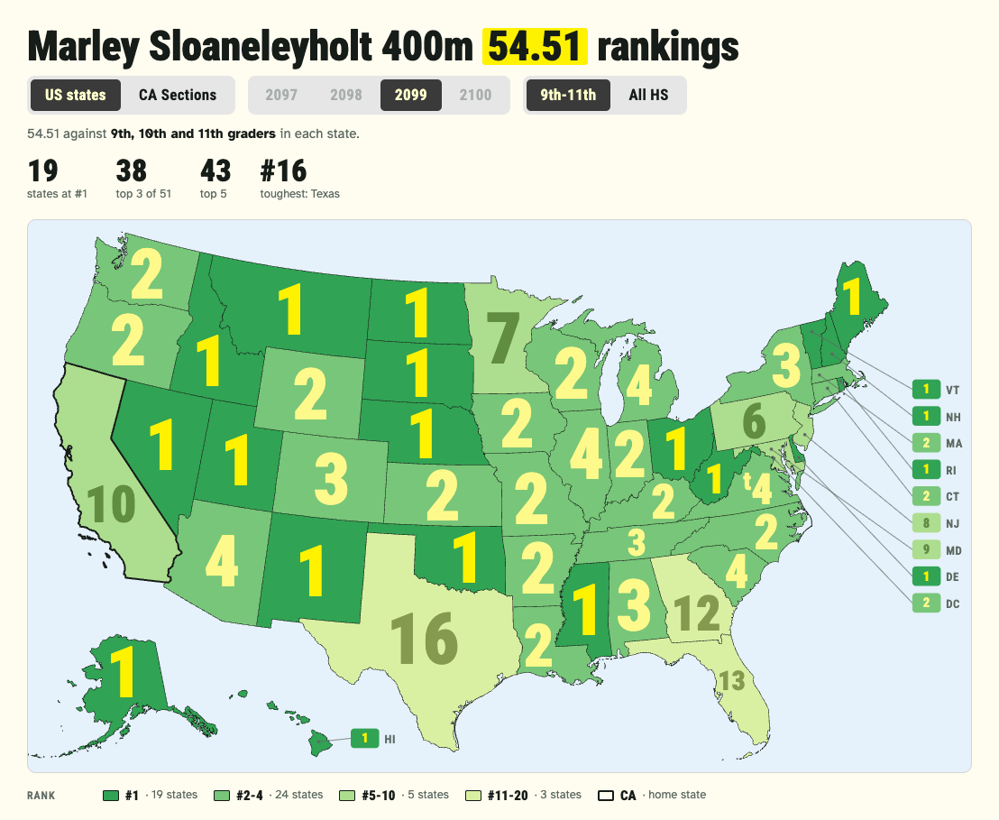
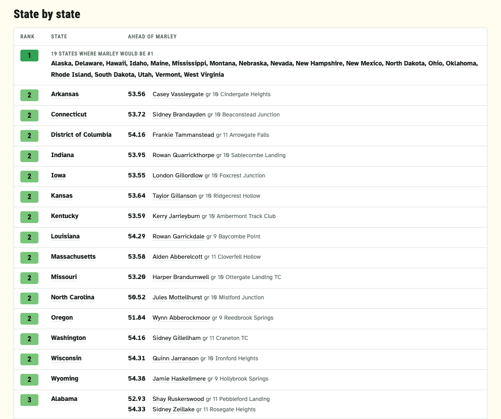

# rankmap

rankmap answers one question for a high school track athlete: where would their season-best mark rank in every US state, and in every Area of their home State?
It builds a single page with a US map, one number per state, and a state-by-state table of who is ahead; when the home State has Areas configured (`areas/<ST>.json`, [`docs/areas.md`](areas.md)), a switch shows the same for the State's Areas: on a county map when they are places (California: the CIF Sections), as cards when they are not (Maine: the MPA Classes, which are school sizes).
It lives in `tools/rankmap/` and gets its data from `ath rank` (see [How it relates to `ath`](#how-it-relates-to-ath)).



*Screenshots use anonymized data (ADR 0010): invented people, schools and marks in the fictional season 2099.*

## What the page shows

- **Season toggle.** One button per high school season, the four years ending with the athlete's graduation year.
  Seasons without data yet are greyed out; the page opens on the newest season it has.
- **Grade-group toggle.** The athlete is compared against 9th grade through their current grade, then one more class at a time up to all of high school.
  A 9th grader sees 9th, 9th-10th, 9th-11th, All HS; a 10th grader sees 9th-10th, 9th-11th, All HS; a senior sees All HS only.
  Each step removes the classes that graduate later, so it shows how the mark holds up against older and older fields.
- **The map.** Each state shows the athlete's rank on that state's list.
  Ranks are colored on one yellow-to-green scale (ColorBrewer YlGn without its darkest green) in five buckets, from green at #1 through 2-4, 5-10 and 11-20 to the palest yellow at 21 or worse.
  Numbers are the header's highlighter yellow on #1 and a softer yellow (halfway to the palest) on 2-4, and past that a shade of their own color close to it, so they read without competing; a tie shows a small raised t (t12).
  Each number is as big as fits in its state (up to a cap), in the biggest box with the number's proportions, pulled toward the state's middle; the Sections map does the same with each whole Section, and a callout's line ends beside its Section's number.
  The smallest states and Hawaii get labeled chips at the edge of the map.
  The athlete's home State (the State whose list their mark is read from) keeps its rank color and is outlined in the page's ink, over its neighbors' borders; when it has a chip, the chip is ringed too and its abbreviation inked dark.
  The legend names it ("CA · home state"), and its tooltip says so.
  Each season marks its own home State, so a season at a school in another State moves the outline.
- **The Sections map.** With "CA Sections" picked (the switch reads the home State's own word), California's counties are colored by the rank in their Section, with Section borders drawn over the county lines and the rank in each Section roomy enough for it.
  Every Section also has a callout off the State's edge naming it in full, coastal ones to the west and inland ones to the east; a Section too small for its rank has the rank in a pill in its callout instead.
  The Los Angeles City and Oakland Sections, which are one school district's schools each, are drawn as their district outlines over their county, in their own color.
  Clicking a Section dims the others, highlights its row in the table, and names its place with a link to its list; clicking it again clears the pick.
  The season and grade group carry over between the two maps, and a link with `#areas-2026-9-10` opens on the Sections map.
  Counties are colored by the Section most of their schools play in; membership is by school, so the map is an illustration (see [`docs/areas.md`](areas.md)).
- **The Classes cards.** For a home State whose Areas are not places (Maine), "ME Classes" shows one card per Class with the rank on its rank color, the athlete's own Class marked ("Gwen's class"), the note on what Classes are, and the class-by-class table.
  Clicking a card highlights its row and names its place with a link to its list, as picking a Section does; there are no headline numbers or legend for the cards.
  At phone width the cards stack, each with its number on the right.
  Under the cards, the athlete's own Class's MPA State Meet for the season: its automatic and provisional standards, which the season best meets, and the seed the athlete's place on the Class list suggests in the grade group picked (no panel for a season without published standards).
- **The State Meet.** Under the Sections map, the CIF State Meet for the season: how many each Section sends per event against the athlete's place there in the grade group picked (checked where it is within them), and the season's at-large mark for the event.
  9th-11th, the season's field without its seniors, is a look at next season's seeding; the Markdown report gives the All HS places and whether the season best is under the at-large mark.
  It is an estimate, and the page says so: the qualifiers are decided by place at each Section's own qualifying meet.
- **Headline numbers.** States (or Sections) at #1, top 3, top 5, and the toughest one.
- **State by state, Section by section.** Best rank first, with every #1 state merged into one alphabetical row.
  Each other state lists the athletes ahead (mark, grade, team); lists longer than six collapse behind a "N faster" line.
  The season's home State has a small "home" tag after its name (and "(home)" in the Markdown), whatever its rank (a highlighted row is a picked Section's, not the home State's).
  State names link to the Athletic.net list used, and athlete names link to their Athletic.net profiles.



## How ranks are computed

For each state, season and grade group, rankmap reads the state's Athletic.net high school performance list with the site's default filters (FAT timing, official marks only).
The athlete's rank is 1 plus the number of athletes on that list with a faster mark, compared on Athletic.net's numeric sort key (`SortIntCalc` on rankings lists), never the display string.
An athlete with exactly the same mark shares the rank, shown as `T3`.
Lists are read past the first 100 rows whenever needed, so a rank like 103 is a real count.
Grades are whatever Athletic.net lists; the site's own grade filter decides who is on each list.

The athlete's mark for a season is their own row on their home state's list for that season (their season best as Athletic.net ranks it).
`ath rank` computes all of it; rankmap renders it.

## Setup

Python 3.9+ (standard library only), `ath` built from this checkout, and a desktop browser for the browser relay.

```bash
cargo build --release
mkdir -p local/rankmap
cp tools/rankmap/rankmap.config.example.json local/rankmap/rankmap.config.json
```

Configs, collected seasons and pages live in `local/rankmap/`, which git ignores (see the README's [`local/` section](../README.md#your-own-configs-and-data-local)).
Without `--config`, rankmap reads `local/rankmap/rankmap.config.json`, or `tools/rankmap/rankmap.config.json` while only that older one exists; it prints the config it uses, and warns when both exist.
`--config rankmap.<athlete_id>-400m` (a name, no folder) reads `local/rankmap/rankmap.<athlete_id>-400m.config.json`; a value with a `/` in it is a path.
In a git worktree, `local/` is the main checkout's (or `$ATH_LOCAL`).
When a config's seasons are still in the main checkout's old default place, `tools/rankmap/data/<athlete_id>-<event>/`, and none are in its `data_dir`, rankmap stops and prints the `mkdir` and `mv` that move them, rather than collect them all again.

rankmap runs `$ATH` when it is set, else this checkout's newest `target/release/ath` or `target/debug/ath`, else `ath` on `PATH`.
It prefers this checkout's build because the JSON it reads is versioned with `tools/`.

| Key | Required | Meaning |
| --- | --- | --- |
| `athlete_id` | yes | The number in the athlete's Athletic.net profile URL (`athletic.net/athlete/<id>/track-and-field`). |
| `event` | yes | Athletic.net's short event code, as in rankings URLs: `100m`, `400m`, `1600m`, `100mH`, `LJ`... |
| `graduation_year` | yes | The athlete's last high school season. Their seasons are the four ending with it. |
| `output_dir` | yes | Where the page, Markdown and CSV are written. Relative paths are relative to the config file. |
| `state` | no | Two-letter home state, whose list the athlete's mark is read from (`ath rank --home`). Otherwise it is their school's state. |
| `data_dir` | no | Where collected seasons are kept (default `data`, beside the config). Relative paths are relative to the config file. |
| `season_end` | no | `MM-DD` after which a season counts as finished (default `07-31`). |
| `artifact_url` | no | A Claude artifact the page is shared at; rankmap prints it after a build, and the page is republished there only when you share it. |
| `theme` | no | A theme file (a path, relative to the config file) whose design tokens replace the house look's: see [Restyling](#restyling) and `tools/theme.example.json`. Without it the pages are the house theme's, byte for byte. |
| `example` | no | `true` builds an example page from anonymized data (see [Publishing](#publishing)); it never collects, as if `--no-fetch` were given. Default `false`. |
| `areas_dir` | with `example` | An example's own State Meet standards: a folder (relative to the config file) with one file, named exactly `<ST>.json`, for each State whose Area file has a State Meet, holding only `{"state_meet": {...}}` with the anonymizer's mapped standards of the meet's kind (`at_large` for a meet by places, `standards` for one by standards) and any `notes`, `sources` and `checked` about them; everything else in an Area file is the repo's `areas/`. A missing, misnamed or stray file, or one of another shape, stops the build. Empty for a State without an Area file. Required for an example, refused otherwise: a real page always reads the published standards. |

For more athletes or events, keep one config each and pass it with `--config`.
Keep them in `local/rankmap/`, for example `local/rankmap/rankmap.<athlete_id>-400m.config.json`.
Configs can share an `output_dir` and a `data_dir`: output files are named by athlete id and event, and each config's seasons are in their own `<athlete_id>-<event>` folder.

## Running

```bash
python3 tools/rankmap/rankmap.py [--config NAME|PATH] [--no-fetch] [--refresh SEASON ...]
```

For each of the athlete's four seasons:

| Season state | What happens |
| --- | --- |
| Upcoming (before January 1 of that year) | Skipped. |
| In progress | Asks whether to pull fresh rankings (default yes). |
| Finished, no data yet | Collected. |
| Finished, already collected | Asks whether to refresh (default no), so finished seasons stay as they were. |

Then it writes `<output_dir>/<athlete_id>-<event>.html`, `.md` and `.csv` (for example `<athlete_id>-400m.html`) from every collected season.
`--no-fetch` builds from saved data only; `--refresh 2026` collects a season without asking.
Without a terminal (for example when an agent runs it), every question takes its default.
A season saved by the retired browser collector (`fetch.js`, before rankmap moved onto `ath`) counts as not collected: it is collected again through `ath`, and left off the page until it is.

### Collecting a season

Athletic.net sits behind Cloudflare bot protection (see [ADR 0001](adr/0001-athletic-net-access-is-cloudflare-gated.md)), so `ath` fetches through the browser relay by default: a real Athletic.net tab runs its requests (see the README's browser relay section).
Before collecting, open an Athletic.net tab and start the relay in it (`ath relay install` prints the bookmarklet and the steps); with `ATH_COOKIE` set, `ath` uses the cookie instead.

Each season is one run of

```bash
ath rank <athlete_id> --event <event> --season <season> --in all,areas --ahead all --grade <grade> --json [--home <state>] [--refresh]
```

- `--in all,areas` places the athlete on all 51 state lists (50 states and DC) and on every Area of their home State (none, with a note, when the State has no Area file), for every grade group, and reports which Area is the athlete's own (`home_area`).
- `--ahead all` lists everyone ahead on each list, which the state-by-state table shows; it reads no more pages than placing the athlete does.
- `--grade` is the grade rankmap computes from `graduation_year`, so past seasons keep their grade groups whatever the profile says now.
- `--refresh` is passed when the season is asked for with `--refresh` or is already saved (collecting it again is a refresh), so fresh data really is refetched instead of read from `ath`'s cache.
  Anything else reads the cache, so a retry after a failed run fetches only what the failed run did not.

That is about 200 lists and a little over 200 requests (40 more for California's ten Sections), around three minutes, paced and retried by `ath`.
`ath`'s cache keeps finished seasons' lists forever and in-season lists 12 hours, so a re-run, or a retry after a failure, is fast.

rankmap saves the season only when the report is whole: it is this config's athlete, event and season, the athlete has a mark, all 51 state lists (and, when the home State has an Area file, its Areas) were read for every grade group, and nobody ahead was left out.
A season with none of the home State's Areas, though the State has a file, still builds, its Sections map saying why: saved before the Sections view, or Athletic.net had none that season (`ath` notes it).
A finished one is collected again for them on each run, reading its lists from `ath`'s cache, so trying again costs little; a season in progress is collected only when asked, as always.
The Sections map is the newest season's home State's; a season at a school in another State shows no Sections on it.
Otherwise, or when `ath` exits non-zero, it says why and keeps the season it already had.
A saved file that fails the same checks (or is not valid JSON) is left off the page and collected again.

The `/rankmap` skill has Claude start the relay in a Claude in Chrome tab and run all of this.

### Publishing

The HTML file is a complete standalone page: drop it on any static host.
It aggregates Athletic.net's lists, so it is meant for the people it is shared with, not the public: it asks search engines not to index, follow or cache it (`robots` meta tag), names Athletic.net only in its links to the lists and profiles, and should be shared privately (a private Claude artifact, or a host behind a login), not posted openly.
An example page (`"example": true` in the config, for the published examples built from anonymized data, ADR 0010) is the other way round.
Every link on it (athletes, lists, the pick line's) goes to one demo page beside it, `demo.html`, in the same tab, which says that links work only on pages built from real data; its CSV has no links; it has no `robots` tag, so search engines may index it; it ends with a footer saying the data is anonymized, that it is built with `ath` from Athletic.net data, not affiliated with or endorsed by Athletic.net, and that real use needs a paid Athletic.net subscription; and its State Meet standards are its own (`areas_dir`), never the published ones.
A page built without `example` is unchanged by it, byte for byte.
`examples/build_site.py` builds the published examples this way ([`docs/anonymize.md`](anonymize.md#the-examples)).
If the config has `artifact_url`, the `/rankmap` skill says after a build that the page shared there is stale and asks whether to republish it.
Republishing is what updates a shared link; pages do not refresh themselves.

## Data

Collected seasons and output live in `local/`, which git ignores: they are personal data about real athletes.
Each season is one file, `<data_dir>/<athlete_id>-<event>/<season>.json`: the `ath rank` JSON report as `ath` printed it, and the day it was pulled.

```json
{"format": 2, "pulled": "2026-10-27", "rank": {"schema": 1, "athlete": {"id": 123, "name": "First Last", "first_name": "First", "url": "..."}, "...": "..."}}
```

The report's shape is in the README (`ath rank`); rankmap reads `athlete`, `gender`, `event`, `event_name`, `mark`, `groups` and, per result, the list's name and state, the grade group, the list URL, and the place with its Neighborhood (everyone ahead, everyone tied).
Every link on the page comes from the report, so rankmap builds no Athletic.net URLs itself.
A change to the `ath rank` JSON shows up as a new `schema`, which rankmap refuses until it is updated.

## Restyling

Every color and font the page uses is a named token in `THEME`, in `tools/report.py` (`house_theme()`), shared with the seed sheet page.
Everything made from the tokens takes a theme (`styles(theme)`, `chips(theme)`, rankmap's `buckets(theme)` and `build(..., theme)`), `THEME` by default, so a page can also be rendered in another theme.

### A theme file

To restyle without touching code, give a config a `theme`: a path, relative to the config file, to a theme file.
Both reports take it (a rankmap config, and a seedsheet config of either kind, which styles the event pages and the meet's index alike).
`tools/theme.example.json` is a whole theme to start from; a theme file needs only the tokens it changes, and every token it leaves out keeps the house value.
Keys starting with `_` are comments.

```json
{
  "bg": "#f7f9fc",
  "highlight_row": "#fff3cc",
  "ranks": [
    {"fill": "#08519c", "ink": "#ffd166"},
    {"fill": "#3182bd", "ink": "#ffe9ad"},
    {"fill": "#6baed6", "ink": "#1d4f75"},
    {"fill": "#bdd7e7", "ink": "#4f7593"},
    {"fill": "#eff3ff", "ink": "#8094ad"}
  ],
  "fonts_url": null
}
```

The tokens are `Theme`'s fields in `tools/report.py`, each written as its type in JSON.
A color or a font stack is text, any CSS value without `;`, `{`, `}`, `<`, `>` or a backslash.
A type size (`copy_px` and the rest) is a whole number of px.
`no_rank` is one `{"fill", "ink"}` object, and `ranks` is a list of exactly five of them, best first, one for each of the legend's rank buckets (#1, #2-4, #5-10, #11-20, #21+).
Two inks follow other tokens in the house theme (#1's ink is `highlight`, an Area with no rank is inked `muted`); in a theme file each is its own value, so set it too when it should follow.
`fonts_url` is the stylesheet that loads the fonts, any `https://` URL, or `null` for no web fonts at all: then the page loads no stylesheet and connects to no font host, and `display` and `body` should be font stacks the viewer has (system fonts).
Google Fonts' hosts are preconnected only when the stylesheet is theirs.
The file is checked strictly: an unknown token (named, with the list of valid ones), a value of the wrong type, a `ranks` of another length, or a missing or extra key in an object stops the build, saying what is wrong.

Changing `display`'s first family needs the new font's `metrics` too, every one of them (below): a theme file without them is refused, saying how to measure them.
Changing only its fallbacks, or any other token, needs nothing more.

### Display font metrics

The map's layout is measured in the display font: a theme's `metrics`.
For the rank labels (weight 900, tabular digits): the digits' advance (`digit_em`), the tie's small t's advance (`tie_em`), the ink's height (`ink_em`), the side bearings the ink leaves out (`bearing_em`), how far the ink's middle sits below a `dominant-baseline: central` anchor (`ink_drop_em`), and how far the tie's t rises to the digits' top (`tie_rise_em`).
For the callouts: a chip's width per rank character (`chip_char_em`), an Area name's width per character (`name_char_em`, weight 700), a state abbreviation's capital (`abbr_char_em`, 700) and its letter-spacing (`abbr_tracking_em`, which the page's CSS uses too).
All are in em of the text's size; the house values are Roboto Condensed's.

To measure a font, open `tools/maps/measure_font.html` in a browser (straight from the file is fine), give it the family and its stylesheet URL, and paste the `metrics` object it prints into the theme file.
It draws each glyph or string as SVG `<text>` at 100px in the right weight with tabular digits, reads advances with `getComputedTextLength()`, the anchor with `getBBox()` (central against alphabetic), and the ink with canvas `measureText()`'s actual bounding box (an SVG `getBBox()` gives the font's line box, not the ink).
The three room metrics (`chip_char_em`, `name_char_em`, `abbr_char_em`) are its measurement scaled as the house font's were.
On Roboto Condensed it gives the house values to within about 0.015 em (the house bearings and drop were measured by hand, a little more conservatively).
It can also run headless: `measure_font.html?family=Oswald&url=<the stylesheet, URL-encoded>` fills in and prints the result.

Where each rank goes on the maps and how big is fitted to these metrics (the label spots).
The house theme's are `tools/maps/label-spots.json`, made by `tools/maps/label_spots.py`; its inputs hash covers the fitted metrics and the display font's first family, so a test fails until it is rerun after a change to the house theme's.
A theme with its own display font or fitted metrics gets its spots fitted on its first build (about ten seconds) and kept in `local/cache/label-spots/<inputs hash>.json`, so later builds read them, and a change to the maps or the fitting fits them again.
The committed file is never written for a theme file.

### In the page

Changing a value in `house_theme()` and rebuilding (`--no-fetch`) restyles every page that has no theme file; nothing else needs to change.
The page colors and fonts reach the CSS as custom properties on `:root` (`--bg`, `--fg`, `--accent`, `--display`, and the rest), one per line.
In `tools/report.py`'s shared CSS the other tokens are written `[[name]]`; in a page template, `{theme.name}`.
The other color tokens go in as values: the rank colors (`ranks`, best first, each a fill and the ink of the number on it; #1's ink is `highlight`), an Area with no rank (`no_rank`, inked `muted`), a picked row (`highlight_row`), the tags on the athlete's own Class card and their home State's row (`tag`, `tag_fg`), and the map panel's edge and county lines.
The home State's outline on the US map, and the ring on its chip, are `fg`, the ink of every State's outline, only heavier.
Five type sizes are tokens too: `copy_px` (copy, the legend's keys, the pick line), `toggle_px` (toggle labels), `chip_px` (a rank in a callout chip), `abbr_px` (a state's abbreviation on the US map, the Class card and home row tags) and `name_px` (an Area's name in a callout or on a Class card).
The callout chips (size, spacing, the gaps and leader lines around them, Hawaii's chip, the US map's room for the callout column) follow `chip_px`, and the State map's callouts follow `name_px`.
Every other size (headings, headline numbers, table text, the Class cards' ranks, the home State's outline, paddings) is the page's layout, in its template in `tools/rankmap/build.py`; the map's rank numbers are sized to fit their state or Area.

A test fails when a color (hex, a color function or a named color as a value) is written out anywhere else in the page code, so new styling becomes a token too.
The page stays light-only, with or without a theme file: there is no dark mode, and the page ignores the viewer's dark-mode setting.

## Files

| File | What it is |
| --- | --- |
| `tools/rankmap/rankmap.py` | The command: plans seasons, runs `ath rank`, builds. |
| `tools/rankmap/build.py` | Reads saved seasons and renders the page, Markdown and CSV. |
| `tools/report.py` | Pieces shared by the reports under `tools/`: finding `ath`, the US map, a State's county map by Area, the design tokens (`THEME`) and light-only theme, toggles, highlight and map panel styling, CSV and atomic JSON writes. |
| `tools/us-states-albers.topo.json` | State shapes: us-atlas@3.0.1 `states-albers-10m` (pre-projected Albers USA). |
| `areas/<ST>.json` | A State's Areas: Athletic.net's level, names, abbreviations, the label pages use, and which counties the map colors for each ([`docs/areas.md`](areas.md)). |
| `tools/maps/<ST>-counties.json`, `tools/maps/extract_counties.py` | A State's county shapes, cut from us-atlas@3.0.1 `counties-albers-10m` (same projection) with the script. |
| `tools/maps/label-spots.json`, `tools/maps/label_spots.py` | Where each rank number goes on the maps and how big, per label shape, in the house theme's display font: the biggest box with the number's proportions that fits in the state or Section, pulled toward its middle. Rerun the script (about ten seconds) when a map file, an Area file's counties, the house display font's metrics or the fitting change; a test says when. |
| `tools/maps/measure_font.html` | Measures a display font's `metrics` for a theme file, in a browser. |
| `tools/theme.example.json` | An example theme file (every token, with Oswald's metrics). |
| `tools/rankmap/test_rankmap.py` | Tests, on a saved `ath rank` report (`testdata/ath-rank-2099.json`) with the expected pages in `testdata/expected/`. |
| `tools/rankmap/rankmap.config.example.json` | Example config. |
| `.claude/skills/rankmap/SKILL.md` | The `/rankmap` agent skill. |

The tests run with `cargo test` (`tests/tools.rs`) or `python3 -m unittest discover -s tools/rankmap`.
`tests/rank.rs` fails when the saved report is no longer what `ath rank` prints (`ATH_BLESS=1 cargo test` refreshes it), and `RANKMAP_BLESS=1` rewrites the expected pages after a deliberate rendering change.

## Athletic.net quirks seen in the data

- A few rows carry a grade one off from the list's filter (an 8th or 11th grader on a 9th-grade list); rankmap follows the site's filter.
- Some runners appear on a neighboring state's list, and occasionally a now-college athlete stays on a state's high school list.
- Athletic.net returns about 100 rows per request; `page` in the query returns the next 100, and neighboring pages share two rows (page 1 is rows 1 to 101, page 2 rows 100 to 201; checked 2026-10-27).

## How it relates to `ath`

rankmap is a report on top of `ath`: `ath rank` reads Athletic.net and places the athlete, and rankmap plans seasons, keeps them, and renders the page.
Since 2026-10-27 it has no Athletic.net code of its own; the browser collector `fetch.js` and its local receiver are retired.
Switching over was checked on 2026-10-27 by re-collecting all three saved seasons (one athlete's 2026, another's 2025 and 2026) with `ath rank` through the browser relay and rebuilding both pages.
Against the pages built from the collector's data (pulled 2026-10-25), the HTML, Markdown and CSV were identical apart from the pulled date and one change Athletic.net made in between: its Florida 2026 high school list no longer has a college athlete it listed first two days earlier.
The rendering alone was checked byte for byte too, by building the collector's data through the new renderer.

### Direction: `ath` owns all Athletic.net data

Decided on 2026-10-26 (glossary in `CONTEXT.md`, decisions in [ADR 0006](adr/0006-pluggable-transport-browser-relay-by-default.md) and [ADR 0007](adr/0007-ath-owns-data-python-reports-render.md)):

- `ath` is the only thing that talks to Athletic.net, through a pluggable transport: a **browser relay** by default (a bookmarklet-started tab that runs `ath`'s requests and posts the responses back over `127.0.0.1`), or a pasted **cookie**.
- `ath` answers data questions with noun commands, `ath profile`, `ath areas`, `ath list`, `ath rank` and `ath seed`, printing JSON when not in a terminal and a table when it is, always with the matching Athletic.net link.
- The cache keeps raw responses by request with freshness by data kind: Area trees and finished seasons forever, in-season lists and Profiles 12 hours, meet entries about an hour.
- Reports, rankmap included, stay in Python under `tools/`, call `ath`, and render pages; `ath`'s versioned JSON is the contract.

Build order, each slice ending in something runnable:

1. Transport: `Fetcher` POST, the browser relay and bookmarklet as default, per-kind cache freshness.
2. Command restructure: `ath seed` (a clean break from the bare form) and `ath profile`.
3. Rankings commands: `ath areas`, `ath list`, `ath rank`, fixture-tested and checked against rankmap's current numbers.
4. rankmap on `ath`: `rankmap.py` calls `ath rank`, `fetch.js` retires, shared report module extracted (done).
5. Area ranking report: built first as a separate several-Athlete page, then folded into rankmap as the home State's Areas map ([ADR 0008](adr/0008-areas-are-configured-per-state-in-files.md)).
6. Seed on Personal record, plus the seed sheet page.
7. Estimated marks, after their own design session.
