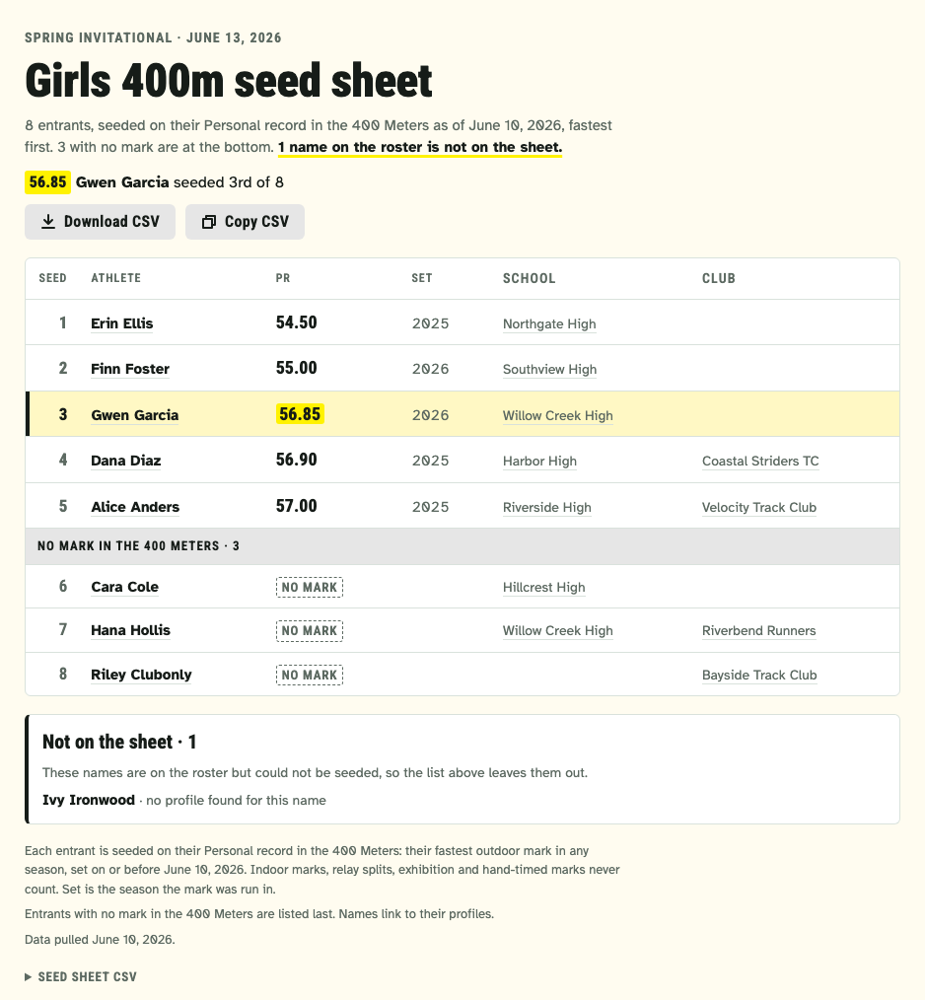
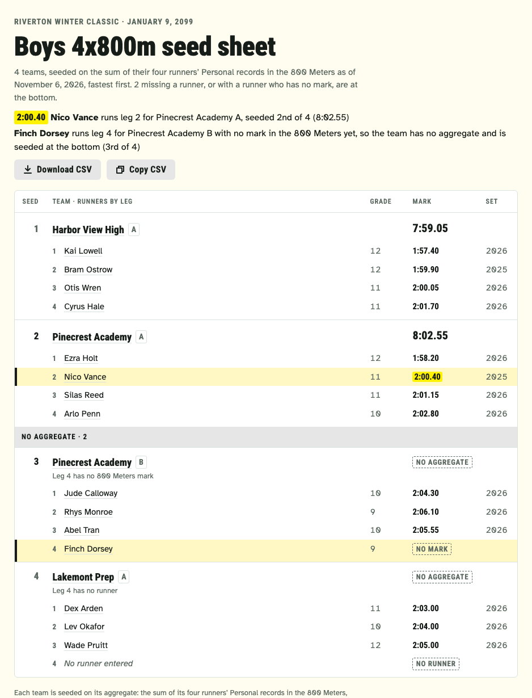

# seedsheet

seedsheet turns `ath seed` into a page you can share: one standalone page per event of a meet, with the entrants in seed order, their Personal records, any Athletes you follow highlighted, and the seed sheet as a CSV download.
Given a meet id, it seeds the meet's own entries and adds an index page listing every event.
It lives in `tools/seedsheet/` and gets its data from `ath seed` and `ath meet` (see [How it relates to `ath`](#how-it-relates-to-ath)).



*The screenshot is the test fixture's page (`tools/seedsheet/testdata/`).*

## Two kinds of config

A config's `meet` says which kind it is:

- **Meet mode**: `meet` is the meet's id, a number (`900700`, the number in the meet's URL).
  seedsheet seeds the meet's accepted entries (`ath seed --meet`, Mode A) for the events you list, or for `"all"` of them, and writes an [index page](#the-index-page) for the meet beside the event pages.
- **Roster mode**: `meet` is the meet's name, text (`"Spring Invitational"`).
  Each event has its own roster CSV (`ath seed --roster`), and there is no index page.

A config written for one kind is refused, with what to change, when it has the other's keys: a roster in meet mode, `"events": "all"` or no roster in roster mode, `meet_date` with a meet id (the meet gives its own date), or a meet id written as text.

## What the page shows

- **Header.** The meet and its date, the event's label, how many entrants there are and the day their marks are as of.
  In meet mode it starts with "All events", a link back to the meet's index page.
- **Your Athletes.** Each configured Athlete on the sheet gets a line with their mark and seed ("56.85 Gwen Garcia seeded 3rd of 8"), and their row is highlighted in the list.
- **The list.** Seed, athlete (linked to their profile), Personal record, the season it was set in, school and club (linked to the team).
  The order is the seed sheet CSV's, exactly: `ath seed` sorts on `SortInt` and the page never re-sorts.
- **No mark.** Entrants with no Qualifying mark in the event sit at the bottom, under a "No mark in the 400 Meters" divider, each marked "No mark".
- **Not on the sheet.** Every roster name `ath seed` could not seed is listed under the table with why: no profile found for the name, more than one possible profile, the search failed, or the profile could not be read.
  The header says how many there are and links to the list, so the entrant count never hides a missing name.
- **The CSV.** The seed sheet CSV, byte for byte what `ath seed` wrote, is carried inside the page three ways:
  - **Download CSV**, a link to the CSV inside the page itself.
    A browser blocks it inside an embedded frame that does not allow downloads: checked in Chrome on 2026-11-02, a sandboxed frame without `allow-downloads` ignores the click.
    Whether a page shared as a Claude artifact can download depends on how claude.ai frames it.
  - **Copy CSV** puts the CSV on the clipboard.
    Where the clipboard is not allowed, or does not answer within a second, it opens the CSV box and selects the text, and says to press Ctrl+C (Cmd+C on a Mac).
  - **Seed sheet CSV**, a collapsed box at the bottom with the CSV as text, to select and copy by hand.
- **Phone width.** Under 640px the season, school and club columns fold into the athlete and mark cells, so the list fits a phone without scrolling sideways.

### A relay's page

A relay's sheet (`ath seed --meet` on a relay of four equal legs, such as the 4x800m) gets its own layout, with the same header, CSV download, Copy CSV and CSV box.

- **The list.** One group per team in seed order: the team (its school, linked, and its letter, `A` or `B`) with its aggregate as the seed mark, then its four runners in leg order, each with leg number, name (linked to their profile), grade, Personal record in the Seeding event and the season it was set in.
- **No aggregate.** Teams missing a runner, or with a runner who has no mark in the Seeding event, sit at the bottom under a "No aggregate" divider; each says why, leg by leg number, as `ath seed` puts it ("Leg 4 has no 800 Meters mark", "Leg 2 has a profile that could not be read", "Leg 3 has no runner", "Same runner on legs 1 and 3"), a runner without a mark is marked "No mark", and a leg with no runner shows "No runner" in its own place.
- **Estimated legs (4xMile).** A runner whose mile (however their profile spells it: `1 Mile`, `Mile`, `Mile Run`), converted to the 1600m and rounded up to the hundredth, beat their 1600m has the converted mark with "estimated from the mile (5:02.10)" under it; their team says "Includes estimated legs", and the header and notes say how the mile is converted.
- **Your Athletes.** A configured Athlete's runner row is highlighted on every team they run on, with a line in the header for each ("2:00.40 Nico Vance runs leg 2 for Pinecrest Academy A, seeded 2nd of 4 (8:02.55)").
- **Profiles not read.** A runner whose profile could not be read stays on their team without a mark, and is named in a section under the list.
- **Phone width.** The grade column folds under the runner's name, and the season under the mark.



*The screenshot is the relay test fixture's page (`tools/seedsheet/testdata/`).*

A roster never seeds a relay, so a relay's page comes from meet mode, which seeds the meet's own entries with `ath seed --meet` (see [Two kinds of config](#two-kinds-of-config)); it links back to the meet's index like any other event page.

The page is light-only (it ignores the viewer's dark mode) and uses the reports' shared type and colors from `tools/report.py` (see [Restyling](#restyling)).
Its only script is Copy CSV's; without script the button stays hidden and the rest of the page works.

## The index page

In meet mode seedsheet writes one index page per meet, `<output_dir>/<meet id>/index.html` (for example `out/900700/index.html`; the page's title is the meet's name), with the event pages and their CSVs in the same folder, so the folder is the whole meet: open `index.html`, or publish the folder.
An event's page and CSV are named by its gender, division id and event code, never by a name (`boys-13-800m.html`), so a renamed division or event keeps its pages and saved sheets.

The folder belongs to one config: seedsheet keeps the list of files it wrote there in `.seedsheet.json`.
A page or CSV it wrote that the index no longer links (an event dropped from the config, or no longer seeded) is removed; any other file is left alone.
A second config for the same meet is stopped with a message to give it its own `output_dir`, so two configs never overwrite each other's pages or index.

- **Header.** The meet's name, its date (from its first to its last day, for a meet over more than one) and place (location, city, state), the season, and a link to the meet's page.
  Then how many of its events are seeded, the day their marks are as of ("seeded as of"), and how many are not.
- **The events.** One row per event, grouped by gender and division (girls first, the divisions in the meet's order), each with:
  - the event's name, linked to its page;
  - Entries: how many are on its sheet, `9 athletes`, or for a relay's sheet (`"kind": "relay"`) `4 teams`;
  - with Athletes configured, how many of them are on it ("Yours", highlighted);
  - its CSV, and its entry list (the event's entries page).
- **Not seeded.** An event `ath seed` does not seed has no page: its row says "Not seeded" and why, in `ath`'s words (a medley or shuttle relay; a field event; an event only run indoors; an event with no accepted entrants or teams; a run that failed; or a saved sheet that could not be read).
  The page says it for the people it is shared with: it leaves out `ath`'s advice for whoever runs seedsheet (a command to run, an option to pass, `(see --season)`, `(ADR 0001)`; the terminal shows it all), and any URL with the "see" that points at it (the row has its entries link).
  It speaks of seeding rather than of `ath` ("relays are not seeded yet"), and where `ath` names Athletic.net, the page says "the results site", or drops the name where it only describes something ("the tab", "a paid subscription").
- **Phone width.** Under 640px the CSV and entries links fold under the event's name.

The index is standalone and light-only like the event pages, styled only through `THEME`, and asks search engines not to index it.
Its header, table, divider, notes and empty-box CSS is the event pages' own (`build.SHARED_CSS`), so the two pages stay in step.
The meet folder holds only what the index links: an event page or CSV seedsheet wrote earlier (named `girls-...` or `boys-...`) that the index no longer links, for an event dropped from the config or no longer seeded, is removed; other files there are left alone.
A meet with no events with entries yet gets an index that says so.

## Setup

Python 3.9+ (standard library only), `ath` built from this checkout, and a desktop browser for the browser relay.

```bash
cargo build --release
mkdir -p local/seedsheet
cp tools/seedsheet/seedsheet.meet.config.example.json local/seedsheet/seedsheet.config.json   # meet mode
cp tools/seedsheet/seedsheet.config.example.json local/seedsheet/spring.config.json          # roster mode
```

Configs, rosters, saved sheets and pages live in `local/seedsheet/`, which git ignores (see the README's [`local/` section](../README.md#your-own-configs-and-data-local)).
Without `--config`, seedsheet reads `local/seedsheet/seedsheet.config.json`, or `tools/seedsheet/seedsheet.config.json` while only that older one exists; it prints the config it uses, and warns when both exist.
`--config spring-invitational` (a name, no folder) reads `local/seedsheet/spring-invitational.config.json`; a value with a `/` in it is a path.
In a git worktree, `local/` is the main checkout's (or `$ATH_LOCAL`).
When a roster config's saved sheets are still in the main checkout's old default place, `tools/seedsheet/data/`, and none are in its `data_dir`, seedsheet stops and prints the `mkdir` and `mv` that move them, rather than fetch them again (after the meet, `ath seed` refuses to).

seedsheet runs `$ATH` when it is set, else this checkout's newest `target/release/ath` or `target/debug/ath`, else `ath` on `PATH`.

### Meet mode

```json
{
  "meet": 900700,
  "athletes": [4001],
  "output_dir": "out",
  "events": [
    {"gender": "m", "div": "V", "event": "800m"},
    {"gender": "f", "div": 13, "event": "1600 Meters", "label": "Girls Varsity Mile"}
  ]
}
```

`"events": "all"` instead of a list takes every event `ath meet <id>` lists, which are the events and divisions with entries (`tools/seedsheet/seedsheet.meet.config.example.json` does that for the made-up meet 900700).

| Key | Required | Meaning |
| --- | --- | --- |
| `meet` | yes | The meet's id (a number). |
| `events` | yes | `"all"`, or a list of events. |
| `events[].gender` | yes | `"f"` (girls) or `"m"` (boys). |
| `events[].div` | yes | The division: its id (`13`, as the entries page's URL has it), name or short name (`"Varsity"`, `"V"`), in any case. |
| `events[].event` | yes | The meet's event: its code (`"800m"`, `"1mile"`, `"4x800m"`), a flat race's short form or name (`"800 Meters"`), or its name, in any case and spacing. `ath meet --resolve` finds it, as `ath seed --meet` would. A bare number (`"800"`) is refused. |
| `events[].label` | no | The event's label on its page and on the index (default: `Boys Varsity 800 Meters` on the page, the event's name on the index). |
| `athletes` | no | Athlete ids (the number in a profile URL) to highlight on every page they are on, and to count on the index. |
| `output_dir` | yes | Where the meet's folder (index, pages and CSVs) is written. Relative paths are relative to the config file. |
| `data_dir` | no | Where the saved meet and sheets are kept (default `data`, beside the config). Relative paths are relative to the config file. |
| `fixtures_dir` | no | Recorded responses for `ath --fixtures-dir`, instead of Athletic.net: for tests and demos (`../../tests/fixtures` from `tools/seedsheet/` runs the made-up meet 900700). |
| `theme` | no | A theme file for the index and every event page (a path, relative to the config file) whose design tokens replace the house look's: see [Restyling](rankmap.md#restyling) and `tools/theme.example.json`. Without it the pages are the house theme's, byte for byte. |

`ath meet <id>` lists each event's gender, division and code: the values `events` takes.
A listed event `ath` does not find (no entries yet, or a typo) is not run; the index shows it as not seeded with `ath`'s reason (`meet 900700 has no 1mile entries in the Varsity division (yet)`).
Two entries for the same event (however each names it, and whatever their labels) are refused.
Each listed event is looked up once per run with `ath meet <id> --gender --div --event --resolve` (from the meet's cached event list, reading no entries), and what it found is saved with the meet, so `--no-fetch` needs no `ath`.

### Roster mode

```json
{
  "meet": "Spring Invitational",
  "meet_date": "2027-04-17",
  "athletes": [4001],
  "output_dir": "out",
  "events": [
    {"label": "Girls 400m", "event": "400m", "roster": "girls-400m.csv"}
  ]
}
```

| Key | Required | Meaning |
| --- | --- | --- |
| `meet` | yes | The meet's name, shown on every page and used in file names. |
| `meet_date` | no | `YYYY-MM-DD`, passed to `ath seed --meet-date`: marks are as of the day before a meet held today, and a past meet is refused. |
| `athletes` | no | Athlete ids (the number in a profile URL) to highlight on every page they are on. |
| `output_dir` | yes | Where the pages and CSVs are written. Relative paths are relative to the config file. |
| `data_dir` | no | Where saved sheets are kept (default `data`, beside the config). Relative paths are relative to the config file. |
| `fixtures_dir` | no | As in meet mode. |
| `theme` | no | As in meet mode. |
| `events` | yes | One entry per page. |
| `events[].label` | yes | The event as the page names it (`Girls 400m`). Labels must give different file names. |
| `events[].event` | yes | The event `ath seed --event` takes: the Athletic.net name (`400 Meters`) or a flat race's short form (`400m`). |
| `events[].roster` | yes | The roster CSV for the event (`ath seed --roster`; `name` required, `athlete_id` pins a person). Relative to the config file. |
| `events[].artifact_url` | no | A Claude artifact the page is shared at; seedsheet prints it after a build, and the page is republished there only when you share it. |

Configs, rosters, saved sheets and output belong in `local/seedsheet/`, never committed: they are personal data about real athletes.

## Running

```bash
python3 tools/seedsheet/seedsheet.py [--config NAME|PATH] [--no-fetch] [--refresh]
```

- `--no-fetch` builds from saved sheets only, without running `ath`: the way to rebuild the pages (and the index) after the meet, when `ath seed` refuses its date.
- `--refresh` has `ath` refetch instead of reading its cache (profiles are cached 12 hours, a meet's events and entries about an hour).
  It goes to every `ath` run: `ath` has no narrower refresh, so in meet mode each `ath seed --refresh` also rereads the meet and its event list (two small requests per event) along with the event's entries and its entrants' profiles, which are what `--refresh` is for.
- When `ath seed` fails or prints no report this build can read, seedsheet says why and keeps the sheet it already had.
  The same goes for a sheet with nobody on it (no roster name resolved, no accepted entrant, or a relay with no accepted team): seedsheet says why, and keeps what it had.
  A sheet's kind says which it is: a relay's sheet is `"kind": "relay"` with `teams`, any other has no kind and has `entrants`.
- When `ath` cannot reach Athletic.net at all (no browser tab connected to the relay, a tab that stopped answering, the network, a Cloudflare challenge or an expired cookie, or the relay's port taken by another `ath`), seedsheet runs no more `ath`, since every event after it would fail the same way.
  The sheets and reasons saved before stay as they were (that failure is never an event's reason); the pages (and in meet mode the index) are built from what is saved, and seedsheet exits saying so: reconnect and run again.
- When Athletic.net refuses the meet itself (its event list or entries need a paid session, or are not published), that is the meet's answer, not a connection problem: seedsheet runs no more `ath` for it, and every event without a sheet saved before is listed as not seeded with that one reason.
- Each event gets one status line: its sheet saved, the sheet kept from before (with the day it was saved) when this run gave nothing new, or not seeded and why.
- Ctrl-C during an event's `ath seed` never becomes a reason either.
  In roster mode it skips that event and goes on with the rest, as before; in meet mode it stops running `ath`, builds the index and pages from what is saved, and exits.
- A saved sheet that is malformed in any way is left out with a message saying why; the other events still build.

### In meet mode

seedsheet first runs

```bash
ath meet <meet> --json [--refresh]
```

and saves its report, with the day it was pulled, as `<data_dir>/<meet>.meet.json`: the meet's name, date and place for the index, and its events with entries for `"all"`.
When it fails, the saved one is used; with none saved, seedsheet stops.
For a config that lists its events, it then runs, once per listed event,

```bash
ath meet <meet> --gender <gender> --div <div> --event <event> --resolve --json
```

which finds the event as `ath seed --meet` would (from the meet's event list ath has cached, reading no entries), and saves what it found, or why not, with the meet.
Then, for each event,

```bash
ath seed --meet <meet> --gender <gender> --div <division id> --event <code> --out <data_dir>/<meet>-<event>.ath.csv --json [--refresh]
```

where `<event>` is the event's file name, `<gender word>-<division id>-<code>` (`boys-13-800m`).
It saves the report, the CSV and the day as `<data_dir>/<meet>-<event>.json`, and writes `<output_dir>/<meet>/<event>.html` and `.csv`, then the meet's `index.html`.

An event `ath seed` refuses or fails on, with no sheet saved before, is not seeded: the run goes on with the other events, and the index lists it with `ath`'s reason (its `Error:` message), saved as `<data_dir>/<meet>-<event>.not-seeded.json` so `--no-fetch` shows it too.
The reason is cleared once the event is seeded.
An event that fails but has a sheet saved before keeps that sheet, and its page.
An event whose saved sheet cannot be read is listed as not seeded, saying so, and the sheet is moved aside (`<name>.json.unreadable`).
When `ath` answers that an event now has no accepted entrants (or a relay no accepted teams), that is the event's status: a sheet saved before is moved aside (`<name>.json.old`) and its page removed, so scratched athletes never stay on a seeded page.
Before running any `ath seed`, seedsheet checks the saved meet's last day (`end_date`, else `date`): a meet that is over runs no `ath seed`, and every event with no sheet saved before is listed with one reason.
If `ath seed` refuses an event because the meet is over, the rest are not run either.

### In roster mode

For each event, seedsheet runs

```bash
ath seed --roster <roster> --event <event> --out <data_dir>/<meet>-<label>.ath.csv --json [--meet-date <meet_date>] [--refresh]
```

and saves its JSON report, the CSV that run wrote (byte for byte) and the day it was pulled, as `<data_dir>/<meet>-<label>.json`.
The page's CSV, its download and its copy are that CSV: seedsheet never writes a CSV of its own.
A sheet saved before this (format 1, without the CSV) is left out with a message to run seedsheet again without `--no-fetch`.
Then it writes `<output_dir>/<meet>-<label>.html` and `.csv`, for example `spring-invitational-girls-400m.html`.

Names `ath` cannot resolve are written to `<roster>.unresolved.csv` for you to pin, as with `ath seed` itself; names it resolves are written back into the roster.

### Publishing

Each HTML file is a complete standalone page: drop it on any static host, or publish it as a private Claude artifact.
In meet mode, publish the meet's folder: the index links to the event pages and CSVs beside it, and each event page links back to `index.html`.
Like rankmap, the pages are meant for the people they are shared with, not the public: they ask search engines not to index, follow or cache them (`robots` meta tag), never name Athletic.net in their own text (their profile, team and entries links go there, as do the URLs in the CSVs), and should be shared privately.

## How it relates to `ath`

seedsheet is a report on top of `ath` ([ADR 0007](adr/0007-ath-owns-data-python-reports-render.md)): `ath seed` reads Athletic.net and ranks the entrants, `ath meet` lists a meet's events, and seedsheet keeps the results and renders the pages.
It never calls Athletic.net itself, and every link on the pages comes from the reports.
`ath`'s warnings and relay instructions reach the terminal as they come; seedsheet also keeps `ath`'s error message to say why an event is not seeded.

`ath seed` prints the sheet as JSON (`schema` 1) next to the CSV it writes; the shape is in the README (`ath seed`, and Relays under `ath seed --meet`).
seedsheet reads `event`, `event_name`, `as_of`, `meet_date`, `skipped`, `unresolved` and each entrant's CSV columns plus `sort_int`, and refuses a report whose order is not seed order (a mark after a no-mark, ranks not 1 to n).
A relay's sheet says `kind: "relay"` (an individual sheet has no `kind`), and seedsheet chooses the page by `kind` alone, never by which keys are there.
It has `teams` in place of `entrants`, plus `seeding_event`, `seeding_event_name` and `estimate_from`; seedsheet reads each team's `rank`, `team`, `letter`, `team_url`, `aggregate`, `sort_int`, `missing_legs`, `same_runner_legs`, `no_aggregate_reason` (shown as is), `estimated` and `legs` (each runner's `leg`, `athlete`, `athlete_id`, `athlete_url`, `grade`, `pr`, `pr_season`, `sort_int`, `estimated`, `estimated_from` and `estimated_from_pr`), and refuses one whose teams are not in seed order, whose legs are not 1 to 4 once each (run or missing), whose aggregate is not the sum of four different runners' `SortInt`s, which has no aggregate without a reason, or whose CSV names other teams or runners.
A change to the JSON shows up as a new `schema` (or an unknown `kind`), which seedsheet refuses until it is updated.
From `ath meet` (`schema` 1) it reads the meet's `name`, `date`, `end_date`, `season`, `location`, `city`, `state`, `url`, `divisions` and `events` (`gender`, `division_id`, `division`, `event`, `event_short`, `url`).

## Restyling

Every color and font the pages use is a named token in `THEME`, in `tools/report.py` (`house_theme()`), shared with the rankmap page.
To restyle without touching code, give the config a `theme`: a theme file (a path, relative to the config file) with only the tokens it changes, over the house values.
`tools/theme.example.json` is one to start from; [A theme file in `docs/rankmap.md`](rankmap.md#a-theme-file) says what each token takes and how strictly the file is checked.
`fonts_url` may be any `https://` stylesheet, or `null` for system fonts only (no stylesheet and no font host is loaded).
These pages draw no maps, so the display font's `metrics` only matter to rankmap, but a theme file that changes `display`'s first family needs them all the same, so one file serves both reports.
Without a theme file, change a value in `house_theme()` and rebuild (`--no-fetch`); nothing else needs to change.
The page colors and fonts reach the CSS as custom properties on `:root` (`--bg`, `--fg`, `--highlight`, `--display`, and the rest, one per line), and the configured Athletes' rows take `highlight_row`.
`build(..., theme)`, `html(..., theme)` and the index's `meet_index.html(..., theme)` take a theme, `THEME` by default, so the pages can also be rendered in another one.
Of the type sizes, only the copy's (`copy_px`) is a token on these pages; the rest (heading, table, marks, buttons) is each page's layout, in its template (`tools/seedsheet/build.py`, `tools/seedsheet/meet_index.py`).
A test fails when a color (hex, a color function or a named color as a value) is written out anywhere else in the page code, so new styling becomes a token too.
The pages stay light-only, with or without a theme file: there is no dark mode.
See [Restyling in `docs/rankmap.md`](rankmap.md#restyling) for the map's tokens.

## Files

| File | What it is |
| --- | --- |
| `tools/seedsheet/seedsheet.py` | The command: reads the config, runs `ath meet` and `ath seed` per event, saves, builds. |
| `tools/seedsheet/build.py` | Checks a saved sheet and renders an event's page (individual or relay) and CSV. |
| `tools/seedsheet/meet_index.py` | Renders a meet's index page. |
| `tools/seedsheet/test_seedsheet.py` | Tests, on a saved `ath seed` report and CSV (`testdata/ath-seed.json`, `testdata/ath-seed.csv`) and a saved relay report and CSV (`testdata/ath-seed-relay.json`, `testdata/ath-seed-relay.csv`: `ath seed --meet` on the made-up meet 900700's boys' 4x800m in `tests/fixtures/meets/`), and a saved 4xMile report and CSV with estimated legs (`testdata/ath-seed-4xmile.json`, `.csv`: meet 900702's girls' 4xMile), with the expected pages in `testdata/expected/`. |
| `tools/seedsheet/test_meet.py` | Meet mode's tests, on saved `ath meet` and `ath seed --meet` output for the made-up meet 900700 (`testdata/meet-900700/`, and the relay report above), with the expected index and event pages in `testdata/expected/900700/`. |
| `tools/seedsheet/seedsheet.meet.config.example.json` | Example meet mode config. |
| `tools/seedsheet/seedsheet.config.example.json` | Example roster mode config. |
| `tests/roster_seedsheet.csv` | The roster the saved report is seeded from: made-up people only, from the hand-built profiles in `tests/fixtures/` (`4001.json`, Gwen Garcia, is the highlighted Athlete; `4002.json`, Hana Hollis, has a school and a club but no 400m mark). |

The tests run with `cargo test` (`tests/tools.rs`) or `python3 -m unittest discover -s tools/seedsheet`; none runs `ath` or reaches Athletic.net, except the ones that run meet mode end to end with the `ath` that `ATH_TEST_BIN` names on the recorded meets 900700 and 900702 (`cargo test` sets it to its own build).
`tests/pipeline.rs` and `tests/seedsheet_meet.rs` fail when a saved report or CSV (individual, relay or meet) is no longer what `ath` produces (`ATH_BLESS=1 cargo test` refreshes them), and `SEEDSHEET_BLESS=1` rewrites the expected pages after a deliberate rendering change.

## Not yet

- Field events, events only run indoors, and medley and shuttle relays: `ath seed` does not seed them yet, so in meet mode the index lists them as not seeded, with why.
- Estimated marks beyond the 4xMile's converted mile (which the relay page flags): when `ath` makes others, they will need their own flag on the page.
